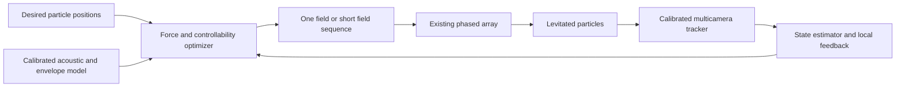

# Toward efficient, independently controllable airborne acoustic particles

Research date: 24 November 2026. Starting point: the report supplied in this conversation. This is an architecture investigation with executed preliminary simulations, not a claim of a new experimental record.

The strongest conclusion is that **there is no established requirement for approximately 20 transducers per particle**. The relevant limit is the combination of controllable force rank, usable spatial modes, available stiffness and power, interaction strength, and dynamic stability. A much more efficient architecture remains plausible, but the supplied report does not prove that a frequency multiplier or a shared support field will deliver it.

My recommended first implementation is **calibrated, force-based single-carrier holography with direct tests of independent motion**. The strongest further capacity hypothesis is **optimized finite-rank temporal acoustic covariance**, using a short sequence of jointly designed fields instead of one persistent coherent hologram. The preliminary results below give a reason to investigate it, and also a reason to avoid selecting it unconditionally: one configuration with positive averaged stiffness is dynamically unstable. None of the executed tests demonstrates hundreds of independently controlled particles.

## 1. Critical Review

### The experimental benchmark needs qualification

The original HAT paper reports fully dynamic 3D manipulation of 12 particles and partial manipulation of 25, including particles escaping during motion. Its array used 512 emitters, approximately 1.2-wavelength pitch, and a 90-Hz update rate. Its reported repositioning accuracy differs between in-plane and 3D operation: approximately ±0.1 and ±0.5 mm. Its 28-trap artifact problem is a result for that system and algorithm. These details should replace an unqualified “25 fully independent particles in 3D” benchmark. [Marzo and Drinkwater, PNAS, 2019](https://pmc.ncbi.nlm.nih.gov/articles/PMC6320506/).

The ratio 512/25 = 20.48 is descriptive. It does not derive a required number of actuators per particle. The report also alternates between N/10 and N/20 while using the same demonstration as evidence. Those are different numerical rules and neither is a physical law.

### The principal physics and mathematical errors

| Claim in the supplied report | Correction and consequence |
|---|---|
| Positive velocity coefficient in Gor'kov potential, with an extra 1/omega² multiplying velocity squared | The velocity term is negative for positive density contrast. The omega² factor appears when velocity is replaced by a pressure gradient, not when physical velocity is already used. This is both a sign and dimensional error. |
| Equilibrium means grad U = 0 | In air under gravity, grad(U + mgz) = 0. Ignoring the gravity displacement biases position and stiffness evaluations. |
| Positive Laplacian establishes stability | Trace of the Hessian can be positive at a saddle. All Hessian eigenvalues must be positive in the conservative, isolated-particle case. A coupled or nonconservative system needs a full dynamics test. |
| All second derivatives being positive is enough | Positive coordinate diagonal entries are insufficient when mixed derivatives are significant. |
| Maximizing pressure at a particle automatically makes a trap | Positive-contrast particles in standing waves commonly sit near pressure nodes. Pressure focusing is an intermediate construction in some holographic algorithms, not the trapping objective itself. |
| Sum of pressure intensities is a linear drive objective | It is quadratic in complex drives. It becomes linear only after lifting to a covariance matrix. |
| lambda_min(nabla²U) | The Laplacian is a scalar. The minimum eigenvalue belongs to the 3×3 Hessian or the full coupled stiffness matrix. |
| Standing-wave nodes must form an independently controllable lattice | One plane standing wave confines one coordinate. It does not create a 3D lattice of isolated traps. Separate orthogonal standing waves can create averaged 3D confinement, but lattice occupancy does not establish arbitrary individual motion. |
| p proportional to cos(kx)cos(ky)cos(kz) is a field at wavenumber k | Its Laplacian is -3k²p. It is not a solution of the assumed homogeneous Helmholtz equation at k. Using k/sqrt(3) in each coordinate fixes the dispersion error but does not automatically make each nodal intersection a stable trap. |
| A few hundred pascals is about 170 dB | With 20 micropa rms reference, 170 dB corresponds to 6.32 kPa rms. 200 Pa rms is 140 dB. Peak and rms amplitudes must be distinguished. |
| Smaller beads necessarily need greater levitation pressure | In the leading Rayleigh model, radiation force and weight both scale as radius cubed, so the gravity threshold is independent of radius. Airflow susceptibility and Brownian displacement get worse as size decreases. |
| Arbitrarily fine trap spacing below lambda/2 is impossible | A Rayleigh spot criterion is not a general theorem about all force landscapes. Superoscillation and near-boundary evanescent structure can make finer features, with severe power, working-distance, stiffness, and robustness costs. Close field minima also do not prove independent particle control. |

The correct Rayleigh scattering and interaction framework is available in [Silva and Bruus, Physical Review E, 2014](https://doi.org/10.1103/PhysRevE.90.063007). The equations in Sections 4 and 5 use peak phasors consistently.

### The spacing and interaction claims are too strong

Wu et al. explicitly report changing the two-particle controllable/collision threshold from about 1.5 lambda to about 0.5 lambda by tilting local standing-wave traps. Their opposite-phase case also changes the primary interference pattern. The report incorrectly treats the original distance as unavoidable and interprets phase-dependent motion entirely as a universal secondary-force law. This paper concerns a two-particle aggregation experiment; it does not establish a dense, robust many-particle display. [Wu et al., Scientific Reports, 2024](https://www.nature.com/articles/s41598-024-70267-z).

Two distinctions are essential. Overlapping fields can merge wells even without particle scattering. Conversely, scattering can destabilize particles even when the empty-volume field has distinct wells. The supplied report conflates these mechanisms. Nor does a generic R^6/r² law represent all acoustic interactions: a common near-node dipole contribution scales as R^6/r^4, with direction and field dependence.

### Frequency and time multiplexing were assessed incorrectly

Adding two tones does not create a second set of particles that ignores the first tone. Ordinary foam particles respond to both. Particle color is not a frequency-selective acoustic property. The 450-channel Puranen apparatus assigned transducers to frequencies and demonstrated two kinds of multifrequency traps, including opposing vortices stabilizing one large EPS sample; it did not demonstrate doubled independent particle capacity. [Puranen et al., IEEE IUS, 2019, original manuscript](https://ewh.ieee.org/conf/ius/2019/media/files/0780.pdf).

There are two valid spectral regimes: fast beats that can be averaged away, and slow beats intentionally used to move a force landscape. Calling all cross-frequency interference negligible erases the second regime. The verified spectral holographic trapping paper is by **Morrell, Lee, and Grier, 2024, Physical Review E**, rather than the report's “Vornehm, 2021, Science Advances” citation. Its low-source-count acoustic conveyor is principally collective axial transport, not independent 3D addressing of hundreds of particles. [Published paper](https://doi.org/10.1103/PhysRevE.109.044901), [author manuscript](https://arxiv.org/abs/2312.03794).

Time sharing can maintain several real particles simultaneously through averaged restoring forces. The particles need not vanish between visits. Duty cycle, settling, force modulation, and stability limit it. A 2025 study demonstrates up to 96 particles in a time-sharing arrangement, but the corresponding conference record confirms that this demonstration was **in water**. It is evidence for the mechanism, not an airborne density record. [Zhou et al., IEEE TUFFC, 2025](https://pubmed.ncbi.nlm.nih.gov/40031676/), [original conference record specifying water](https://epapers2.org/uffc2024/ESR/paper_details.php?paper_id=7274).

### Shared support was dismissed prematurely

For fields at the same frequency, support and local control have a coherent cross term. They cannot be treated as independently additive potentials. A properly optimized residual field can alter one particle's force while compensating the forces on others. Whether this works is a rank-and-power question, not a theorem that shared fields forbid independence.

A strong periodic support field also creates barriers. It may make fine lateral steering inexpensive but full vertical motion expensive. Therefore support-plus-steering must be evaluated at three separate levels: stable storage, local independent 3D displacements, and unrestricted reconfiguration over the display volume.

### Other unsupported or incomplete statements

The cited 250,000-element IMEC panel and “Levy 2017” hundreds-of-traps result lack enough bibliographic detail in the supplied report to substantiate the stated specifications. Membrane count, independently driven channel count, air-coupled pressure, and usable bandwidth are distinct quantities. The alleged StableLev reference is also misidentified: the verified work is a CHI 2024 paper, not the report's UIST attribution. [Author publication record](https://leigao-oriana.github.io/).

The suggested enclosure is not a passive detail: reflections change the transmission matrix. A hand in air is a strongly scattering impedance boundary; treating it only as an absorbing obstacle is inadequate. Increasing global power to “freeze” disturbed particles is not a justified recovery strategy.

## 2. New Discoveries

These are discoveries relative to the supplied report, not claims of publication priority.

1. **The waveform's covariance is a useful design variable.** At fixed target positions, radiation force, stiffness, and selected barrier constraints are linear functions of a positive semidefinite drive covariance. A static coherent drive supplies rank one. Multiple temporal fields can physically realize a higher-rank covariance, provided switching dynamics permit it. This opens a much larger design space without adding emitting elements.

2. **An SDP is already relevant to acoustic control.** SMART uses semidefinite methods for acoustic trap manipulation. It supports investigating lifted quadratic optimization, but its demonstrated real-time single-object manipulations are not a many-particle capacity result. The proposed extension here is to realize a feasible high-rank covariance as a measured finite-duration waveform and certify independent motion. [Zehnter et al., Scientific Reports, 2025](https://www.nature.com/articles/s41598-025-93153-8).

3. **Phase-transition dynamics can dominate nominal phase resolution.** Temporal Acoustic Point Holography develops phase-retrieval methods that constrain changes across frames to suppress transducer amplitude fluctuations. It is not simply the same idea as switching a trap among particles. This is the right warning against interpreting an FPGA's command rate as acoustic bandwidth. [Christopoulos et al., SIGGRAPH, 2024](https://doi.org/10.1145/3641519.3657443), [official conference abstract](https://www.siggraph.org/wp-content/uploads/2024/09/Conference-Papers.html).

4. **Scattering boundaries can be included efficiently.** A published BEM-based acoustic holography system reported more than 10,000 solver updates per second for applications involving static scattering surfaces. This does not establish high particle-count independence or real-time adaptation to arbitrary moving hands, but it shows that boundary modeling need not be excluded from the controller. [Hirayama et al., Science Advances, 2022](https://pmc.ncbi.nlm.nih.gov/articles/PMC9205589/).

5. **Collapse can be changed through particle properties.** Electrostatic charging has been demonstrated as a complementary way to separate acoustically levitated particles and alter assemblies. This directly contradicts an unconditional “particles closer than a wavelength must aggregate” statement. Repulsion improves separation; it does not supply independent addressing by itself. [Shi et al., PNAS, 2025](https://pmc.ncbi.nlm.nih.gov/articles/PMC12718382/).

6. **Passive boundaries can create useful spatial complexity.** Reflective metamaterials have demonstrated multiple static airborne traps, including non-half-wavelength vertical separations. Their paper also reports a gap between favorable empty-field simulations and attempted close-particle levitation. That is a useful caution for our simulation hierarchy. [Polychronopoulos and Memoli, Scientific Reports, 2020](https://pmc.ncbi.nlm.nih.gov/articles/PMC7060201/).

7. **Pressure nodes are not the only architecture worth testing.** A 2026 PRL demonstrates single-sided levitation in the high-pressure core of a zero-order Bessel beam, including multiparticle support and a long working distance. Independent many-particle 3D addressing is not established by its abstract. This should become a force-model investigation, not an immediate design assumption. [Koroyasu et al., Physical Review Letters, 2026](https://doi.org/10.1103/pfkh-4x7j).

8. **Field measurement itself can be accelerated.** Thermographic measurement and camera-in-the-loop optimization have been demonstrated for in-air ultrasound fields. The method measures pressure-related magnitude in a plane and does not supply acoustic phase or particle coordinates. It is a possible calibration tool, not a replacement for 3D tracking. [Morgan et al., Communications Engineering, 2025](https://www.nature.com/articles/s44172-025-00439-w).

The main mathematical insight is to separate **field complexity**, **particle retention**, and **independent control**. A visually complex intensity pattern proves none of the last two.

## 3. Five or More New Architectures

The following eight designs go beyond simply adding frequencies or dividing a volume among copies of the same array. Each has a falsifiable benefit. The first three have concrete implementations in the delivered screening code, together with the older baselines and a simple aperture candidate.

### N1. Force-based, controllability-aware holography

Use the existing emitting elements, but optimize complex drives for gravity-balanced forces, minimum Hessian eigenvalues, barrier height, and an adequately conditioned control Jacobian. Start from an IB hologram, then solve the physical force problem. Maintain phase continuity, warm-start each frame, and use a local model-based feedback update instead of recomputing a global solution every camera frame.

This changes what the controller spends its degrees of freedom on. A particular trap shape or a specified pressure value is not imposed unless needed. Three force components per particle are constrained, while shape is allowed to adapt. Small singular values identify motions that would consume excessive control effort.

Potential benefit: recover capacity lost to unnecessary pressure constraints, gravity offsets, unequal stiffness, and poorly conditioned force control. Limitation: it cannot overcome a genuinely inadequate acoustic power or spatial-mode budget. Falsification: after amplitude/phase capability, calibration, power, and optimizer effort are matched, it does not improve the complete independent-motion pass rate over a strong baseline. Implemented as `static_force`.

### N2. Optimized finite-rank temporal covariance

Use S short holograms per repeating cycle. Jointly optimize all fields, their eventual duty allocation, and their ordering for the **sum of their force landscapes**, rather than requiring a complete persistent trap for every particle in each slot. Some instantaneous wells may be weak or unstable; the complete periodic mechanical system must remain stable.

Group nearby interfering traps into different slots while grouping compatible traps together. A graph can be built from measured force leakage, scattering, and phase-transition cost. This differs from both singleton scanning and a static global lattice: the number of fields can be much smaller than the number of particles, and the sequence is optimized jointly.

Potential benefit: remove selected coherent cross terms and widen controllable force rank at fixed emitter count. Limitations: power duty, peak drive, resonance settling, time-varying axial stiffness, and micromotion. It must outperform N1 with the same actuator capability. A mean-field SDP solution alone is insufficient. Falsification: no finite-S sequence remains advantageous after envelope filtering, Floquet analysis, full interaction models, and independent motion tests. Implemented as `covariance`, with equal duty and up to four fields; variable duty, graph search, and dynamic stability optimization are specified research extensions.

### N3. Coherent support with localized force residuals

Maintain a known support waveform and add a bounded residual at the same frequency. The resulting potential includes a term linear in the small residual through coherent interference. Design the residual by solving for the desired change at one particle and zero force changes at other particles; choose the smallest feasible drive change.

If u = u0 + delta_u, then U = u0†A u0 + 2 Re(u0†A delta_u) + delta_u†A delta_u. The reference can therefore provide useful control sensitivity. This is a homodyne-like force-control mechanism, not an extra energy source.

Potential benefit: individual steering can use small updates around a shared field. Limitation: a periodic support field can lock particles to layers and impose expensive vertical barriers. Compensating all neighbors may erase the local-control advantage. Falsification: the residual cannot produce independent ±1-mm displacements in all three directions with bounded power and adequate stiffness. Implemented as `support_residual`; the chosen fixed axial reference is only one candidate and performs poorly in the preliminary cloud tests.

### N4. Axis-switched or tilted support with shared correction modes

Time alternate physically valid standing-wave families with different wavevector directions. The averaged potential can provide confinement in all three coordinates. Tilt the strongest stiffness direction toward close neighbors, and synthesize a small number of shared correction modes to break lattice symmetry at occupied sites.

This combines a cheap support geometry with the experimentally motivated use of trap tilt. Unlike the supplied cos-product field, every constituent must satisfy its own dispersion relation. If frequencies are separated instead of time switched, all particles still see the sum of their potentials.

Potential benefit: allocate strong restoring directions where interactions or motion require them. Limitation: a static or globally translated lattice remains collective. Corrections must demonstrate full-rank local 3D control, then site-to-site transport. Falsification: the required corrections need the same power and actuator effort as independently synthesized traps, or vertical transitions systematically disturb occupied neighbors. Not yet implemented as a complete architecture; the delivered common-support baseline is a useful negative comparator.

### N5. Passive boundary co-design with a small active mode basis

Optimize a reflector or cavity boundary to establish favorable confinement and reduce axial ghost wells. Use a few active spatial modes for reconfiguration, rather than actively reproducing the passive field at every frame. Jointly choose emitter positions, passive geometry, and the residual basis using a BEM transmission matrix and a force-Jacobian objective.

Potential benefit: resonant storage or passive focusing can improve useful stiffness per input watt and actuator effort. A fixed passive boundary transforms the controllable modes; it does not create new independent input channels. A high-Q cavity stores energy but resists fast changes: the approximate amplitude settling time is Q/(pi f).

Falsification: the measured controllable force rank or bandwidth is inadequate, or the passive geometry only supports a fixed pattern. A tunable boundary adds actuators that must be counted separately. The small `aperiodic` code case tests only a weak aperture perturbation; it is not a simulation of the full passive-boundary architecture.

### N6. Frequency-selective particle engineering

Investigate hollow shells, internal resonators, or compliant inclusions with distinguishable force spectra. Co-design particle response and field spectra so that the response matrix between particle classes and frequency bands is well conditioned. Color may serve as an optical identity tag but has no presumed connection to the acoustic spectrum.

Potential benefit: reduce spectral cross-talk and decouple classes. Limitation: classes still require spatial addressing internally. Closely separated tones acting on ordinary nonresonant foam have almost identical material responses. A resonance also adds absorption, force phase shifts, orientation dependence, and fabrication variability.

For an illustrative Lorentzian class response, a power-selectivity ratio of ten between tones separated by delta_f requires Q approximately at least 1.5 f0/delta_f. At f0 = 40 kHz and delta_f = 800 Hz, this is Q about 75, implying about 0.60-ms particle-response settling. These are calculations for a proposed response model, not a demonstrated foam-particle capability. Falsification: real material spectra lack the required selectivity or resonant instability outweighs the cross-talk reduction.

### N7. Acoustic confinement with controlled electrostatic separation

Use acoustic fields for levitation and most positioning, while controlled like-sign charging supplies repulsion against collapse. Optimize the full coupled stiffness, rather than treating Coulomb force as an independent per-particle trap. If electrodes also provide individual steering, count their channels and power in the architecture cost.

Potential benefit: turn near-neighbor collapse into a tunable interaction problem. Limitation: electrostatic repulsion does not make a set of arbitrary target positions stable automatically, and charge drift changes equilibria. Long-range Coulomb coupling can make independent motion harder. This is distinct from a dielectric microfluidic device in water.

At q = 1 pC and separation 1 mm, Coulomb repulsion is about 9 nN, comparable to a substantial fraction of the 19.3-nN weight of our assumed 0.5-mm EPS bead. This calculation illustrates a relevant force scale, not a target charge specification. Falsification: separation improves but the full independent-motion pass rate or usable volumetric stiffness fails to improve.

### N8. Dynamically stabilized force landscapes and nonlinear mode generation

Allow a deliberately oscillating saddle or modulated field to stabilize particles dynamically. A fast potential modulation can create an effective slow potential proportional to |grad V1|²/(4m Omega²). Alternatively, nonlinear propagation generates harmonics with shorter wavelengths.

Potential benefit: stable averaged motion may exist where static confinement is unfavorable. Limitations: the modulation or harmonics are constrained functions of the original drive, not freely programmable channels. The effective stabilization decreases as modulation frequency increases at fixed amplitude; resonances, streaming, heating, and emitted audible components may dominate. Harmonic generation needs a nonlinear propagation model, not Gor'kov plus linear superposition alone.

Falsification: no robust stable region survives power limits, bandwidth, and perturbations, or the new force structure is too weak to improve independent control. This is a lower-priority physics experiment, not the first display prototype.

Useful combinations are N1+N2 for waveform discovery, N2+N3 for a steady reference with scheduled corrections, N4+N7 for close-neighbor stability, and N5+N1 for passive confinement with adaptive control. Every combination must be compared against its components: gains can be canceled by power splitting or added barriers.

## 4. Physics Analysis

### Consistent governing model

Use peak phasors with time dependence exp(-i omega t). For frequency k and drive vector u_k,

\[
p_k(r)=h_k(r)u_k,\qquad (\nabla^2+k_k^2)p_k=0,\qquad
v_k=\frac{\nabla p_k}{i\omega_k\rho_0}.
\]

Here h is a calibrated transfer row, including the appropriate source directivity and boundaries. A far-field approximation must be justified for the individual emitter; a Fraunhofer approximation for the entire array is not generally justified at levitation working distances.

For a small, nonabsorbing spherical particle of volume V,

\[
U_k=V\left[\frac{f_0|p_k|^2}{4\rho_0c_0^2}
-\frac{3f_2\rho_0|v_k|^2}{8}\right],
\quad f_0=1-\frac{\kappa_p}{\kappa_0},\quad
f_2=\frac{2(\rho_p-\rho_0)}{2\rho_p+\rho_0}.
\]

The contrast coefficients require real material measurements when foam compressibility, shell resonance, or loss matters. Gor'kov's conservative approximation requires ka small; absorption, nonconservative scattering, finite-size corrections, and thermoviscous effects must be added when relevant. The supplied simulation uses ka about 0.183.

Under rapid, incoherent temporal or spectral averaging,

\[
\bar U_i=\sum_{s,k}d_s U_{i,s,k},\quad
F_i=-\nabla_i\bar U_i-m_i g\hat z+F_{\mathrm{int},i}
+F_{\mathrm{other},i}.
\]

At equilibrium F_i = 0. For an isolated conservative particle, K_i = Hessian(U_i+mgz) = Hessian(U_i) must be positive definite. Gravity affects the equilibrium location even though its potential has zero Hessian.

The coupled dynamics are

\[
M\ddot q+\Gamma\dot q=F(q,u),\quad
D=-\frac{\partial F}{\partial q},\quad B=\frac{\partial F}{\partial u}.
\]

For conservative interactions, use the full 3M×3M Hessian. For nonreciprocal or nonconservative interactions, assess eigenvalues of the state matrix

\[
\mathcal A=\begin{bmatrix}0&I\\-M^{-1}D&-M^{-1}\Gamma\end{bmatrix}.
\]

All eigenvalues must have negative real parts for asymptotic stability. Checking only each particle's 3×3 block can miss a collective instability.

### What actually constrains independent control

Define the equilibrium response C = D^{-1}B, when D is nonsingular. Independent small 3D motions require rank C = 3M, with singular values sufficiently large to make the requested corrections feasible under drive limits. At motion frequency Omega,

\[
G(i\Omega)=(-\Omega^2M+i\Omega\Gamma+D)^{-1}B.
\]

A full-rank static C can still have inadequate dynamic bandwidth or enormous power cost.

A phase-only single-frequency field has at most N-1 force-relevant real parameters because common phase is irrelevant. A freely controlled amplitude-and-phase field has at most 2N-1. Thus generic quasistatic independent 3D positioning requires, respectively,

\[
3M\le N-1,\qquad 3M\le2N-1.
\]

These are necessary dimension counts for that control class, not sufficient capacities and not universal bounds on time-dependent feedback or nonacoustic actuators. For N = 512, they give 170 and 341 particles, respectively. The operational limits can be much lower. Temporal control can access multiple averaged force modes; count the independent waveform parameters, usable time bandwidth, and the rank after filtering, rather than applying the instantaneous bound indiscriminately.

### Eight bottleneck categories

| Category | Governing quantity | What can be improved; what remains unavoidable |
|---|---|---|
| 1. Fundamental physics | Momentum and energy conservation, finite-size validity, attainable field spatial spectrum | Reshape useful modes and choose materials; cannot obtain arbitrary force gradients at zero energy or ignore propagation/scattering. |
| 2. Acoustic interference | Coherent cross terms, ghost-well barriers, transfer-matrix conditioning | Joint optimization, covariance/time sharing, aperture/boundary co-design, phase continuity. Removing cross terms between different slots does not remove all unwanted wells. |
| 3. Control degrees of freedom | Rank and smallest singular values of C or G | Additional usable temporal modes, improved geometry, response diversity. Passive optics/acoustics alone do not add active input dimension. |
| 4. Particle interactions | Off-diagonal D blocks, nonreciprocity, collision basins | Smaller particles, lower scattering contrast, trap tilt, electrostatic repulsion, interaction-aware synthesis. Interactions cannot simply be omitted at high density. |
| 5. Acoustic power | Real-power quadratic form, weakest stiffness, pressure and basin depth | Avoid wasting field energy, exploit passive confinement. Splitting fixed power over more tones or visits still reduces available stiffness. |
| 6. Transducer hardware | Measured impulse response, transfer function, peak current/voltage, thermal limits | Better drive waveforms, lower-Q/wider-band sources, calibrated phase transitions. FPGA timing is not membrane settling. |
| 7. Computation | Field/gradient evaluations, optimization latency, control-matrix conditioning | Cached transfers, automatic differentiation, matrix-free adjoints, sparse/local models, fast incremental feedback. Full fresh optimization every frame is expensive. |
| 8. Sensing and feedback | 3D covariance, occlusion, identity errors, latency | Multiple calibrated cameras, prediction, model-based filtering. Feedback cannot compensate for inadequate controllable force rank or a particle lost outside its basin. |

### Power and particle-size scaling

For a plane standing-wave pressure p0 sin(kz), the maximum primary force magnitude is

\[
F_{\max}=\frac{Vk p_0^2}{4\rho_0c_0^2}(f_0+\tfrac32f_2).
\]

Consequently the necessary gravity threshold is

\[
p_{0,\min}^2=\frac{4\rho_0\rho_pc_0^2g}{k(f_0+\tfrac32f_2)}.
\]

For the explicitly assumed 40-kHz, 30-kg/m³ particles in the code, this is about **307 Pa peak**. It establishes a one-dimensional force threshold, not 3D trapping, a permitted exposure, or a multi-particle power budget. Radius cancels. Stiffness scales approximately as a³p²k² times a geometry factor. In Stokes flow, drag scales as a, so deflection under the same airflow scales approximately as a^-2.

For our 0.5-mm particle and minimum stiffness 17.44 micronewtons/m, a 1-cm/s airflow produces approximately 49-micrometer deflection using Stokes drag. At higher velocities, check Reynolds number and replace Stokes drag. Streaming at operating acoustic pressure may create comparable flow and is a potentially serious unmodeled limit.

### Spectral and temporal dynamics

For two tones, the radiation force contains carrier-averaged beat components. The displacement driven by a beat force amplitude F_b is approximately

\[
|x_b|=\frac{|F_b|}{\sqrt{(K-m\Delta\omega^2)^2+(\gamma\Delta\omega)^2}}.
\]

Test this against the allowable positioning error. Saying delta_f exceeds an unspecified “inertia” threshold is insufficient. Slow beats can intentionally make a conveyor, with speed c delta_f/(2f0) for a simple counterpropagating pair; that motion is collective unless additional addressing breaks the symmetry.

For singleton duty d = 1/M, an ideal averaged stiffness is approximately d times the on-slot stiffness, before leakage or settling. An off interval T_off also permits displacement of order g T_off²/2 if there is no other support. At 0.1-mm allowable gravitational excursion, this crude necessary estimate gives T_off under about 4.5 ms; it is not a complete stability criterion.

Model complex emitter envelopes as dot u_a = (u_command-u_a)/tau or with the measured higher-order response. For periodic local mechanics, compute the monodromy matrix

\[
\Phi=\prod_s\exp(\mathcal A_s d_sT_c).
\]

Require spectral radius rho(Phi) < 1 and bounded micromotion. Fast averaging must be assessed against relevant **fast mechanical modes**, not only the weakest trap frequency. This distinction matters in our executed eight-particle example.

Propagation of a changing envelope also has a travel-time constraint: source n contributes u_n(t-R_n/c), not an instantaneous common envelope. A 60-mm path difference corresponds to about 0.175 ms in air. This is comparable to the assumed emitter settling and becomes significant for short slots. The delivered quasistationary envelope model omits spatially retarded envelopes. A higher-fidelity implementation must use retarded transfers or frequency-resolved sidebands and their beat dynamics. Its mean covariance can then be optimized in that extended spectral basis; a single carrier covariance with unchanged transfers is only an approximation.

### Spatial density is separate from control capacity

At 40 kHz in 343-m/s air, lambda = 8.575 mm. A 60-mm cube can geometrically contain 5³ = 125 centers on a 1.5-lambda cubic spacing, or 14³ = 2,744 centers at 0.5 lambda, ignoring boundary/capture margins. These are site counts, not feasible particle counts. A 10×10×10 grid spanning 60 mm has spacing 6.67 mm, about 0.78 lambda. Its simultaneous retention, controllable rank, interactions, power, and visibility all remain unproved.

Increasing frequency changes this geometric scale but also changes emitter response, absorption, element pitch in wavelengths, finite-size scattering, and field conditioning. It is not an architecture-independent capacity multiplier.

## 5. Optimization Model

### Define the desired operational count first

An independently controlled particle must be retained while its commanded position changes and all other particles remain within tolerance. Specify an operating class before reporting M: workspace, maximum path speed/acceleration, update rate, allowed error and cross-talk, minimum separation, disturbance distribution, retention time, and control resource limits.

For a target configuration and drive u*, let C = D^-1B. Local rank is a necessary test. A stronger finite test commands positive and negative displacements along all three axes for each particle, then simultaneous randomized motions and collision-free trajectories. Let delta be a requested move and q*(u') the actual equilibrium. For every held particle j,

\[
\|q_j^*(u')-q_j^*(u^*)\|\le\epsilon_{\rm hold},\qquad
\|q_i^*(u')-q_i^{\rm target}\|\le\epsilon_{\rm move}.
\]

Both the moved and held particles must retain adequate stability and basin depth. A parked lattice that allows only collective translation fails this definition.

### Lift the quadratic physics to a covariance

Let h be a row of pressure transfers and H_v the 3×N velocity-transfer matrix. For particle i at a fixed position,

\[
A_i(r)=V_i\left[\frac{f_{0,i}h^\dagger h}{4\rho_0c_0^2}
-\frac{3f_{2,i}\rho_0H_v^\dagger H_v}{8}\right],\quad
U_i=u^\dagger A_i u.
\]

For a sequence, define

\[
Q=\sum_s d_su_su_s^\dagger\succeq0,\quad\sum_s d_s=1.
\]

Then Ubar_i = tr(A_iQ), acoustic force components are -tr((partial_a A_i)Q), and Hessian entries are tr((partial_ab A_i)Q). At fixed sites, force balance and stiffness matrix inequalities are affine in Q. Independent frequencies need separate Q_k and A_i,k; the same particles feel all of them.

This lifting is not a claim that an N×N covariance supplies N² useful spatial modes. Many matrices map to nearly the same forces; positivity, aperture, power, and bandwidth constrain the attainable image. Measure its rank and conditioning.

### A fixed-target SDP feasibility problem

For a chosen M, solve

\[
\min_{Q\succeq0}\ \operatorname{tr}(RQ)
\]

subject to

\[
\begin{aligned}
&-\operatorname{tr}(\partial_a A_iQ)+F_{{\rm other},i,a}=m_ig\delta_{az},\\
&[\operatorname{tr}(\partial_{ab} A_iQ)]_{a,b}\succeq\kappa_{\min,i}I,\\
&\operatorname{tr}(RQ)\le P_{\max},\quad Q_{nn}\le u_{n,\rm rms,max}^2,\\
&\operatorname{tr}([A_i(r_b)-A_i(r_i)]Q)+m_ig(z_b-z_i)\ge E_{\rm basin},
\end{aligned}
\]

where r_b samples a capture boundary and R is a measured real-power matrix. At fixed geometry this can provide an optimistic feasibility bound. A certified infeasible SDP rules out that target set within the specified model and constraints. Failure of a nonconvex local optimizer does not.

An SDP feasible Q need not correspond to a single coherent drive. A spectral decomposition Q = sum lambda_s v_s v_s† suggests temporal fields u_s = sqrt(lambda_s/d_s) v_s. Peak drives, slot durations, transitions, and particle dynamics must still be checked. Recovering one rank-one drive throws away the reason for considering temporal covariance.

### Optimize actual count and performance

Use a lexicographic objective: first maximize the count passing the operational independence contract; then minimize electrical/acoustic power; then maximize the weakest stability margin and conditioning; then minimize tracking error and solve latency. This avoids an arbitrary weighted sum favoring many unstable or unsteerable particles.

For each M, positions, paths, modes, duties, emitter geometry, and boundaries are generally nonconvex variables. Useful constraints include

\[
\begin{aligned}
&\|r_i-r_j\|\ge d_{\min},\quad r_i\in\Omega,\quad
\|\dot r_i\|\le v_{\max},\quad \|\ddot r_i\|\le a_{\max},\\
&\lambda_{\min}(D_{\rm sym})\ge\kappa_{\min}\ \text{when appropriate},\\
&\max\Re\lambda(\mathcal A)\le-\eta\ \text{or}\ \rho(\Phi)\le1-\eta_d,\\
&\sigma_{\min}(W_qCW_u)\ge s_{\min},\\
&\sum_{s,k}d_su_{s,k}^\dagger R_ku_{s,k}\le P_{\max},\\
&\max_t|\sum_k u_{n,k}e^{-i\omega_kt}|\le u_{n,\rm peak,max},\\
&t_{\rm solve}+t_{\rm transport}+t_{\rm sensing}\le T_{\rm update}.
\end{aligned}
\]

Dimensionless weighted variables W_q and W_u prevent unit-dependent conditioning metrics. Position accuracy should include measurement covariance, model bias, and disturbance response, not only floating-point residuals. Optimize conservative perturbation bounds or empirical quantiles over calibration error, airflow, particle-property variation, and tracking latency.

### Differentiation and algorithms

The source propagation, potential, force, and drive gradients are differentiable. For a real objective J, phase derivatives follow by chain rule through u_n = a_n exp(i phi_n). For fixed geometry, precompute pressure and velocity transfers; an adjoint multiply by H† accumulates drive sensitivities efficiently. Spatial derivatives and mixed Hessians must be retained.

For scattering solve L z = b, use implicit differentiation: dz = L^-1(db-dL z). For BEM, the same principle differentiates boundary parameters without resolving every independent drive perturbation. For trajectories and periodic dynamics, differentiate the integrator or solve a time-domain adjoint. Differentiating matrix exponentials supports Floquet-aware objectives, with caution near repeated eigenvalues and stability boundaries.

A practical search alternates SDP bounds, low-rank factorization Q = YY†, multistart gradient optimization, waveform scheduling, and robust simulation. Use smooth approximations to minimum eigenvalue during learning, then exact eigenvalues for acceptance. Optimize geometry offline using adjoints or modest Bayesian search. Use model-based incremental corrections online. Reinforcement learning may aid model-error compensation after a calibrated physical controller exists; it does not supply a missing force mode.

The delivered code implements differentiable force/stiffness optimization over complex drives with hard projected drive bounds and post-solve independence/Floquet tests. It does **not** implement the full SDP, global capacity search, arbitrary boundary co-design, or full robust trajectory optimization. Those are specified experiments, not claimed completed computations.

## 6. Simulation Plan

### Common benchmark and executed implementations

The delivered Python/PyTorch code runs eight configurations: IB-style holography, force-optimized static holography, two-tone control, a fixed global support plus sequential local traps, singleton time sharing, optimized temporal covariance, coherent support-residual control, and a slightly aperiodic array.

| Parameter | Common assumption within each comparison |
|---|---|
| Main emitter count | 512, in two opposing 16×16 arrays |
| Source pitch and disk radius | 10 mm and 4.5 mm |
| Array separation | 160 mm |
| Evaluated particle volume | Central 60×60×60-mm cube |
| Carrier | 40 kHz; two-tone case uses 39.6 and 40.4 kHz |
| Air | Density 1.2 kg/m³; sound speed 343 m/s; viscosity 1.81×10^-5 Pa s |
| Particle | Radius 0.25 mm; density 30 kg/m³; assumed compressibility ratio 0.01 |
| Source calibration | Assumed 2 Pa m pressure coefficient; finite disk quadrature |
| Drive effort ceiling | 256 unit-emitter equivalents; per-emitter peak magnitude no greater than one |
| Nominal acoustic reference ceiling | Approximately 1.493 W from isolated-piston radiation; electrical watts uncalibrated |
| Required weakest stiffness | 17.44 micronewtons/m, equivalent to an undamped 15-Hz weakest mode for the assumed particle |
| Mean equilibrium accuracy | 0.10 mm |
| Temporal sequence | Up to four covariance fields; singleton baseline visits each particle; default cycle 5 ms |
| Assumed emitter amplitude settling | 0.16 ms; separately tested a 1-ms sequence cycle |
| Position targets | The same seeded volumetric cloud for each requested count and every architecture |

The 128-emitter comparison uses opposing 8×8 arrays, a 100-mm separation, and a central 30-mm cube. The 32-emitter prototype study uses opposing 4×4 arrays and a smaller workspace. Those studies have common assumptions internally; their counts are not compared as if aperture, workspace, and power were unchanged across N.

The common power limit is an upper bound. Some fixed support implementations do not use all of it. The two-tone crest constraint is explicitly enforced; doubling tones does not double the permitted source voltage. Real acoustic and electrical power need a calibrated radiation/impedance matrix. The current number is a nominal conservative reference, and should not be equated with the report's electrical-power figures.

### Four simulation levels

**Level 1: verified empty-volume screening.** Compute finite-disk source transfers, pressure gradients, the correct Gor'kov potential, force, and all mixed Hessian terms. Optimize drives; find gravity-balanced equilibria; test the continuous control Jacobian and finite independent displacements. All eight implementations have been executed at 128 emitters with 2 and 4 targets and at 512 emitters with 8 and 16 targets.

**Level 1b: leading interaction sensitivity.** The delivered `scattering_check.py` adds the first Rayleigh-scattered field from other particles and the leading cross terms in the interaction potential. With G = exp(ikr)/r,

\[
p_{\rm sc,j}(r)= -\frac{f_{0,j}k^2a_j^3}{3}p_{\rm ext}(r_j)G(r-r_j)
-\frac{f_{2,j}a_j^3}{2}\nabla p_{\rm ext}(r_j)\cdot\nabla G(r-r_j).
\]

Differentiate with respect to the probe position when computing its force, exclude self scattering, then move each physical source particle to build the full coupled force Jacobian. A separate analytic control reproduces near-node dipole attraction proportional to r^-4 to about 0.8% at the test separation. This is a mathematical control, not an experimental validation. The approach is limited to dilute Rayleigh scattering; close-contact and finite-size calculations require higher-order methods.

**Level 2: calibrated geometry, interactions, and dynamics.** Replace ideal source transfers with measured complex responses; include enclosure/reflector boundaries with Helmholtz BEM. Extend particle scattering with a multipole T-matrix or boundary-element stress calculation. Solve the multiple-scattering system self-consistently, include thermoviscous corrections, and evaluate the full coupled dynamics. Implement complete beat dynamics for simultaneous tones. Add streaming and finite-Re drag.

**Level 3: nonlinear and hardware prediction.** Use full-wave propagation with absorption and nonlinearity where needed, measured driver/membrane impulse responses, thermal drift, sensing noise, latency, and calibration uncertainty. Simulate loading, trap-to-trap transfer, failures, collision avoidance, and dummy-hand boundary motion. Full-wave methods are expensive and should validate shortlisted designs rather than run every optimization iteration. BEM provides the right linear boundary framework; [Bempp's Helmholtz operators](https://bempp.com/handbook/api/boundary_operators.html) are an available implementation option. k-Wave or a suitable finite-element acoustic solver can be evaluated for higher-fidelity propagation.

### Exact experimental sweep protocol

1. Freeze a benchmark: N, emitting area, aperture bounds, source limits, total real power, particle properties, and usable volume.
2. Use M = 2, 4, 8, 16, 25, 50, 100 and further counts only while a previous count remains feasible. Sample multiple target clouds, layers, close pairs, and adversarial geometries. Include a planar benchmark separately from unrestricted volumetric targets.
3. Run a strong phase-only baseline with gravity compensation and measured phase continuity, then an amplitude/phase baseline. Match actuator capability before attributing a gain to temporal or spectral architecture.
4. For temporal designs sweep S, duties, field ordering, and cycle time. For tones sweep spacing, bandwidth, and material-response matrices. For support designs vary support power and quantify vertical barriers.
5. At each candidate, test equilibria, full stiffness/dynamics, escape basins, and unwanted capture wells. A grid or directional basin test should reject ghost wells that compete with intended trajectories.
6. Command every particle by ±0.25 and ±1 mm along all axes, holding the others. Then command independent randomized paths at increasing speed and acceleration. Estimate the complete cross-talk matrix, not only a mean error.
7. Run complete nonlinear particle trajectories and disturbance trials for a predeclared retention interval. Test sudden command transitions, airflow, calibration errors, changed particle mass, lost detections, and recovery.
8. Count a configuration only if **all** particles meet the specified contract. Report success fractions over clouds with confidence intervals. A failed local optimizer is an optimizer failure unless an independent feasibility bound excludes the target.

The delivered screening performs positive 0.25-mm probes at 128 emitters. Negative moves, 1-mm excursions, arbitrary simultaneous trajectories, long retention, and robust high-density capacity are not certified. At 512 emitters the executed screen omitted the expensive finite probes, so none of those rows is labeled independently controlled.

### Metrics and reporting

Record independent count M_ind, N/M_ind, minimum stiffness, full-system stability margin, capture radius/energy, minimum successfully controlled spacing, rms and worst-case position error, maximum passing trajectory speed and acceleration, real acoustic/electrical power, solve latency, memory, update rate, tracking uncertainty, and retention probability. Keep an “unperformed” value explicit instead of converting it to zero.

The scripts save the seed, configuration, target positions, complex commands, result rows, toolchain versions, and a SHA-256 source snapshot. `tracking.py` is a runnable local transient model with frame holds and emitter settling. It reports its offline compute latency and explicitly states when the requested update rate is not achieved.

## 7. Architecture Comparison

### Executed 128-emitter local tests

These are model results from one target cloud at each count. The 2-particle and 4-particle clouds differ; all architectures share the same cloud at a given count. “Pass” is only the delivered local Tier-1 contract: six positive 0.25-mm probes for two particles, adequate stiffness, accurate equilibrium, available control rank, and local periodic stability. It is not a hardware or unrestricted 3D independence certificate.

| Configuration | 2-target weakest stiffness, micronewtons/m | 2-target local result | 4-target weakest stiffness, micronewtons/m |
|---|---:|---|---:|
| IB-style phase holography | 27.52 | Fail: gravity/position error and cross-talk | 10.11 |
| N1 force-based static | 30.54 | Pass | 5.46 |
| Two simultaneous tones | 26.09 | Static probes pass; beat dynamics incomplete | 9.40 |
| Fixed global-local baseline | 6.15 | Fail | 0.41; equilibrium did not converge |
| Singleton time sharing | 27.07 | Fail: three of six finite probes | 5.51 |
| N2 temporal covariance | 28.48 | Pass | 7.82 |
| N3 coherent support residual | 13.34 | Fail: stiffness | -0.60 |
| Slightly aperiodic static array | 30.70 | Pass | 5.39 |

Every four-target case fails the 17.44-micronewtons/m weakest-stiffness requirement. The covariance case improves weakest stiffness by **43.2%** relative to the amplitude/phase static case, but does not meet the requirement. The local force Jacobian has full row rank in these attempted cases. This makes weak stiffness/power and field efficiency the immediate limits in this particular screen, not a lack of Jacobian rank.

The passed two-particle static case has model equilibrium error below 0.001 mm and held-particle displacement below 0.3% of the commanded move in the finite probes. These small numerical residuals are not physical accuracy predictions: source calibration, particle properties, and sensing uncertainty are missing.

### Executed 512-emitter screen

The 8-target cloud has minimum center spacing 12.28 mm; the 16-target cloud has minimum spacing 9.51 mm. The nominal power ceiling is the same within both counts. “Sites meeting local criteria” evaluates sites in the complete attempted field; it is **not** a demonstrated stable subset after removing other targets, and not an independent-particle count.

| Configuration | 8-target weakest stiffness, micronewtons/m | 8-target periodic/mean-field finding | 16-target weakest stiffness, micronewtons/m | Sites meeting local criteria in 16-target field |
|---|---:|---|---:|---:|
| IB-style | 22.72 | Large position error | -2.86 | 0 |
| N1 force-based static | 30.90 | Local periodic stability passes | 8.30 | 9/16 |
| Two-tone | 25.90 | Beat dynamics not tested | 10.61 | 3/16 |
| Fixed global-local baseline | 3.53 | Weak stiffness/position error | -0.88 | 0; no convergence |
| Singleton time sharing | 20.31 | Position error; field not independently certified | 7.58 | 0 |
| N2 covariance | 28.87 | Unstable Floquet multiplier observed: 1.183 | 15.53 | 11/16 |
| N3 support residual | 11.20 | Weak stiffness | 1.81 | 0 |
| Slightly aperiodic static | 31.49 | Local periodic stability passes | 8.34 | 8/16 |

At 16 targets the covariance field improves the weakest stiffness by **87.1%** over the static force optimizer, but the complete configuration still fails the required stiffness. The two-tone case does not double count and is dynamically incomplete. The tiny aperiodic perturbation produces no convincing efficiency advantage in these tests. None of these rows proves a new independent particle count.

### Timing, scattering, convergence, and computation

Shortening the eight-target covariance cycle from 5 ms to 1 ms, with the same assumed 0.16-ms emitter settling, removes the observed local periodic instability: the multiplier becomes approximately 0.979 and sampled ripple approximately 0.0011 mm. However, weakest stiffness falls to **15.58 micronewtons/m**, below the required value. This is a concrete power/bandwidth/stability tradeoff, not an automatic scheduling improvement.

The leading scattering check shifts the static eight-target equilibrium by up to about 1.10 micrometers and the static sixteen-target equilibrium by about 2.12 micrometers. For these small beads and relatively large separations, that interaction model does not explain the much larger stiffness shortfall. These shifts are model sensitivities and comparable to some numerical/model uncertainties; they are not measured particle movements. Denser or larger particles can behave differently.

Halving the spatial stencil in one two-particle static case changes weakest stiffness by about 0.0042%. Increasing disk quadrature from 24 to 384 patches changes it by about 0.44%, with an estimated fixed-field equilibrium shift below 1 micrometer. This is a limited convergence check of the ideal-source model, not a validation of real transducer behavior.

The executed local trajectory test moves one of two particles on an x-z path while holding the other. At 2-Hz path frequency, 0.25-mm amplitude, and 50-Hz command frames, the model gives rms tracking error about **0.0165 mm**, maximum error **0.0267 mm**, and maximum held-particle drift **0.00086 mm** over the 0.20-s test. Commanded path speed is 3.14 mm/s; it is not a measured maximum speed. The fresh optimizer takes approximately **0.70 s per frame** on this host, so this implementation does **not** achieve real-time 50-Hz control. Cached Jacobian/MPC updates are needed.

In the separate low-bandwidth prototype study, 32 sources and two particles pass the delivered local tests when the required weakest-mode frequency is reduced to 5 Hz: weakest stiffness is about 5.13 micronewtons/m for static force control and 4.73 for covariance. Both fail the 15-Hz main requirement. This supports investigating a small slow-control experiment, not claiming that 32 sources meet the main display specification.

### Ranking for the next research investment

The ranking is a judgment about evidence, feasibility, and expected information value, not a fabricated quantitative hardware performance table.

| Rank | Architecture | Reason |
|---:|---|---|
| 1 | N1 calibrated force-based holography, with phase-continuous incremental feedback | Best supported immediate build; avoids the observed temporal instability; same emitter count; meaningful physical objective. |
| 2 | N2 finite-rank temporal covariance added to N1 | Strongest further capacity hypothesis and sizeable model stiffness gains; actual bandwidth and periodic stability can erase them. |
| 3 | N3 coherent support-residual control; consider N4 tilted/axis support | Valuable mechanism to test; current fixed-support examples are poor and full vertical mobility is unproved. |
| 4 | Joint multifrequency control | Demonstrated trap-shape benefits; ordinary particles are not separately frequency addressed; crest and power limits remain. |
| 5 | N5 passive-boundary/aperture co-design with an active residual basis | Could improve energy efficiency and ghost-well structure; requires calibrated BEM and a usable reconfiguration basis. |
| 6 | N7 controlled-charge separation | Direct evidence that collapse can be altered; does not establish independent addressing and adds charge control. |
| 7 | N6 resonant particle tagging | Potential spectral separation, but usable particle spectra and stability are unknown. |
| 8 | Singleton scanning or the supplied fixed global-local storage concept | Useful comparators and possibly storage modes; no demonstrated high-density independence advantage under our contract. |
| 9 | N8 dynamic-saddle/nonlinear-harmonic schemes | Interesting physics with major modeling and stability uncertainty; insufficient evidence for first hardware investment. |

Redistributing the same sources among more viewing directions remains worth co-designing, but a distributed module arrangement by itself is not an efficiency result. Static passive holograms can be highly efficient storage structures; they are not counted as independent-control systems until their active mode basis passes the motion contract.

## 8. Best Proposed Architecture

### Recommended build: a calibrated force-control array with optional optimized temporal modes

Build N1 first on a modest opposed array. Measure source transfers and phase-transition response. Optimize gravity-balanced forces, worst stiffness, capture basins, and the independent-control Jacobian. Use camera feedback with cached local updates and phase-continuity constraints. Do not impose a manually chosen pressure shape when a different force landscape performs better.

The physical architecture remains a shared acoustic field. The improvement is in what the field is asked to accomplish and how efficiently the controller uses the available modes. It can outperform a pressure-only controller when that controller wastes stiffness, fails to compensate gravity, or creates poorly conditioned forces. It cannot guarantee a dramatic capacity increase if acoustic power or spatial modes already dominate.

After that baseline is calibrated, permit a small number of temporal modes and optimize them for actual filtered drives and full periodic dynamics. Include a steady reference component only if measured experiments show that it improves the difficult mechanical axes without imposing excessive barriers. Begin with S = 2 or 4, not one independent visit per desired voxel.

This recommendation does not assert that temporal covariance already beats static force control. The executed tests support a stiffness hypothesis, while rejecting some naive temporal implementations. **The largest uncertainty is whether the covariance advantage survives the combination of real emitter bandwidth, full coupled stability, and capture-basin constraints at useful particle counts.**

A meaningful improvement target is M_ind,new at least twice M_ind,baseline under the same N, total real power, emitting area, workspace, particle distribution, and motion contract. For example, after a qualified baseline count is measured, test whether twice that count can be retained and moved independently at 20-Hz command frames for 60 seconds. This is a predeclared research target, not a prediction. An equally useful positive result would be halving source count at matched independently controlled count, without adding hidden active boundary or electrode channels.

## 9. Implementation Roadmap

### Stage 0: reproduce the software and calibrate model uncertainty

Use Python, NumPy, PyTorch automatic differentiation, and the supplied scripts. Reproduce analytic standing-wave stiffness, gravity, coherent/incoherent addition, emitter-envelope filtering, and the r^-4 interaction control. Check finite-difference and source-quadrature convergence. Extend the transfer model to measured pressure/phase and real-power calibration.

Success: source/model predictions agree with calibrated single-trap force or oscillation measurements within a predeclared 10% tolerance over the selected workspace. Failure: unexplained sign, factor, or stiffness errors, substantial hysteresis, or source variation outside the robust-model range. Do not extrapolate particle capacity while the source calibration is wrong.

### Stage 1: smallest meaningful independent-control experiment

Use **32 emitters in two opposing 4×4 arrays** for a slow two-particle experiment, if the low-bandwidth simulation and measured stiffness support it. Use a lower predeclared weakest-mode requirement of 5 Hz for this prototype; it is a different operational class from the 15-Hz main benchmark. If that inexpensive apparatus cannot supply the required measured stiffness, use the already simulated 128-emitter arrangement for the same two-particle hypothesis before considering a larger display.

Required equipment: synchronized phase-controllable driver channels, a microcontroller with precise timing or small FPGA, current-limited supply within the chosen transducer rating, two adjustable mounts, two matched foam spheres, two calibrated cameras or one camera plus a carefully calibrated optical second view, illumination, and a phase-capable acoustic probe. Reuse available oscilloscope and measurement equipment. Begin with one carrier and omit new frequency hardware, passive surfaces, hand tracking, and nonlinear schemes.

An open controller design such as [Ultraino](https://research-information.bris.ac.uk/en/publications/ultraino-an-open-phased-array-system-for-narrowband-airborne-ultr/) is a useful reference, but its timing and phase resolution must be evaluated against the intended sequence. Select drive amplitude from the transducer's rated limits and measured pressure, not from the assumed gain in the simulator. No current supplier prices or complete hardware quotes were verified, so the report does not repeat the earlier budget figures as established costs.

First hypothesis: a corrected force objective can move either particle by ±0.25 mm along all axes while holding the other within 0.10 mm and preventing escape for 60 seconds. Measure stiffness from perturbation ringdown or calibrated force; the minimum eigenvalue should meet the 5-Hz prototype requirement. Then compare the same targets using one coherent field, two jointly optimized fields, and naive singleton scanning at identical measured power.

Success: both particles pass all positive and negative moves, tracking identities remain reliable, and sequence performance survives calibrated phase transitions. Failure: held-particle displacement exceeds tolerance, either particle escapes, measured stiffness falls short, or a temporal sequence only appears stable in the averaged model. This experiment tests independence and waveform efficiency; a basic two-transducer levitation demonstration alone would not.

### Stage 2: isolate the temporal-stability hypothesis

Measure each source's complex step/impulse response for phase changes. Sweep sequence period and mode count while tracking particle motion at sufficient frame rate to detect micromotion. Compare measured periodic stability against Floquet predictions. Use a static array configuration as the power-matched control.

Success: predicted stable/unstable sequence regions correctly identify physical behavior, and a nontrivial sequence improves useful stiffness or retention at matched power. Failure: transition-induced amplitude collapse or a parametric instability eliminates the predicted gain. If temporal methods fail, retain N1 and investigate geometry/passive boundary optimization instead of assuming more slots will help.

### Stage 3: calibrated many-particle and close-spacing test

Use a single fixed apparatus, preferably 128 emitters initially, and increase particle count only while each complete configuration passes the operational contract. Integrate two or three cameras with shared timing, stereo calibration, multiview triangulation, identity tracking, and a state estimator. Predict through short occlusions; declare failure on unrecoverable identity swaps rather than treating them as missing data.

Use a cached control Jacobian with trust-region updates, a constrained quadratic program, and a model-predictive trajectory generator. Warm-start a slower global optimizer when layout changes. FPGA/MCU buffers should provide deterministic phase/amplitude updates independent of camera timing. Measure acquisition, inference, transport, driver, and acoustic latency separately.

Success: a complete new architecture achieves at least twice the baseline independently controlled count, or at least 25% lower real power at matched count and motion contract, across repeated target clouds with uncertainty intervals. Failure: only storage count improves, trajectories require sequential parking outside the contract, or the gain vanishes after calibration and interaction modeling.

For close pairs, sweep spacing and trap tilt with the same small particles. Measure force/cross-talk and stiffness instead of assuming collision at 1.5 lambda. Failure below a distance establishes a limit for that material and control system; it is not a universal acoustic theorem.

### Stage 4: boundaries, particle engineering, and display integration

Only after a robust control advantage exists, test passive boundary co-design, material spectra, or charge-assisted separation. Include their hardware channels and losses in the resource comparison. Use rigid dummy-hand objects to validate scattering updates before live interaction. A five-sided enclosure can improve aperture coverage but also causes resonances, occlusion, and inaccessible particle-loading paths.

Measure ultrasound and audible by-products at accessible positions under actual operating waveforms. A single enclosure-edge decibel number is not a complete exposure assessment. Do not increase power automatically during hand intrusion. Design particle unloading and safe loss-of-levitation behavior along with detection and field adaptation.

For optical use, qualify particle visibility, optical occlusion, color projection, and loading/removal. Global RGB illumination gives a common color; independently colored voxels require spatially addressed light and calibrated optical tracking. Hundreds of small particles can also obscure one another and the cameras. A high static point count is not yet a high-resolution interactive display.

## 10. Unresolved Questions

1. What is the optimal achievable M_ind versus source count and real power after a sufficiently strong optimizer, rather than this particular local search?
2. How many temporal force modes remain distinct after measured emitter filtering, and what is the minimum sequence period consistent with mechanical stability?
3. Can a steady support component suppress axial parametric instability without locking vertical positions or consuming the useful local-control budget?
4. At sub-wavelength spacing, when do field merging, finite-size scattering, collective modes, electrostatics, or collisions become the dominant limitation for the chosen particles?
5. Can resonant particles provide reproducible, stable spectral selectivity in air, with adequate mechanical bandwidth and low absorption?
6. Does a co-designed boundary or sparse multiview aperture improve the smallest controllable singular values at fixed emitting area and power?
7. How much model error and streaming can incremental feedback correct before its latency or force authority becomes limiting?
8. What particle size preserves visibility while permitting high count, low scattering, reliable tracking, and manageable airflow susceptibility?
9. Can hundreds of particles be loaded, identified, retained, independently illuminated, and removed without fragile manual procedures?
10. How does a moving hand change the usable control modes, capture basins, accessible sound field, and optical sensing geometry?

The present numerical evidence answers none of these globally. It does establish that arbitrary transducers-per-particle rules, empty-field minima, and positive averaged stiffness are insufficient acceptance criteria.

## 11. Next Research Experiments

| Experiment | Controlled comparison | Evidence produced | Success/failure criterion |
|---|---|---|---|
| Force objective versus pressure objective | Same two particles, source drives, real power, geometry, and calibrated gravity offset | Position error, weakest stiffness, full finite-move cross-talk | Useful gain after gravity compensation and actuator capability are matched; otherwise no algorithmic efficiency claim |
| Temporal covariance versus coherent control | Same target cloud and source limits; S = 1, 2, 4 | PSD feasibility, actual filtered waveform, stiffness, retention, Floquet margin | Higher complete passing count or lower real power; reject any positive-average but unstable sequence |
| Phase-transition measurement | Repeat calibrated phase steps at multiple amplitudes | Complex envelope, tau or higher-order response, amplitude loss | Predict mechanical sequence behavior within predeclared error; revise model if not |
| Support-residual independence | Common support varied while every neighbor is tracked | Residual power versus displacement, vertical barriers, held-particle errors | All-axis independent moves pass at lower cost; reject merely lateral or collective gains |
| Pair spacing and trap tilt | Same particles and power; controlled phase/tilt/spacing sweeps | Collision threshold, scattering shift, stiffness and dynamic cross-talk | Replicable smaller usable spacing with retention; do not infer universal spacing from one configuration |
| Passive boundary or aperture co-design | Same N, emitting area, and power; empty and occupied volumes | Transmission singular spectrum, control rank, weakest stiffness, ghost basins | More usable force authority without hidden active channels; reject fixed-pattern storage as independent control |
| Material or charge intervention | Identical field protocol; measured spectra or charge distributions | Separation, particle-property variation, full coupled dynamics | Improved complete motion contract, not just reduced aggregation |
| Capacity curve with sensing and disturbances | Multiple seeded clouds and randomized independent paths | M_ind(N,P), speed, error, retention probabilities, compute latency | Predeclared twofold-count or matched-count power target with reproducible uncertainty bounds |

The first three experiments provide the highest information per hardware expense. Begin with the two-particle force/sequence comparison and emitter phase-transition measurement. Use the resulting calibrated model to decide whether the next investment should be temporal control, passive/geometry co-design, or particle interaction engineering.

All delivered simulation values come from saved executions. The code and model are sufficient to repeat the stated preliminary tests. They do not prove an optimum, a hardware particle count, or a scalable high-resolution display; the proposed capacity advantage remains a falsifiable research hypothesis.
