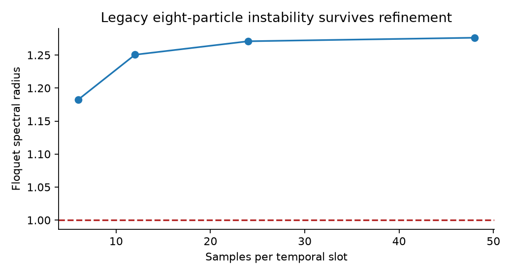
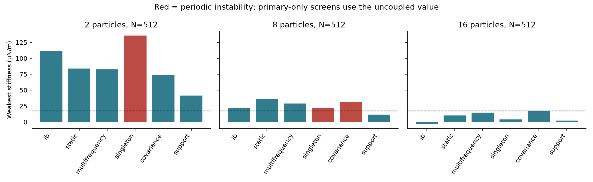
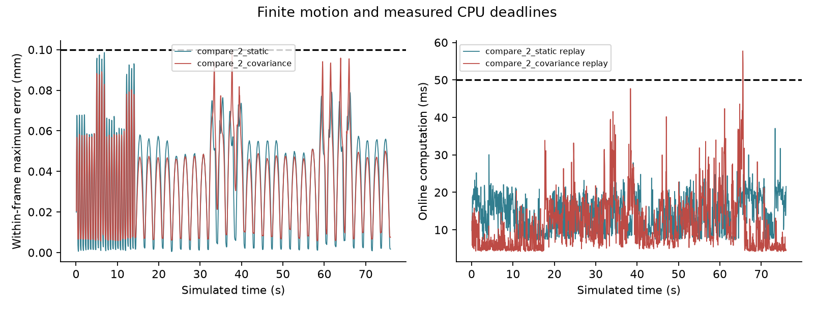
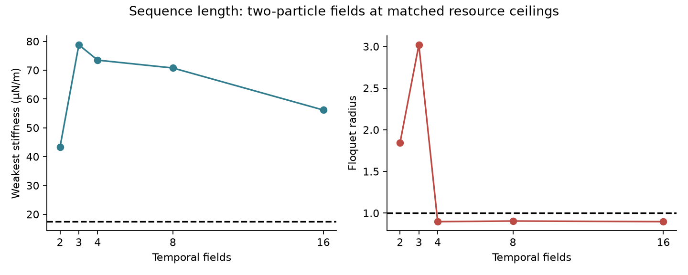
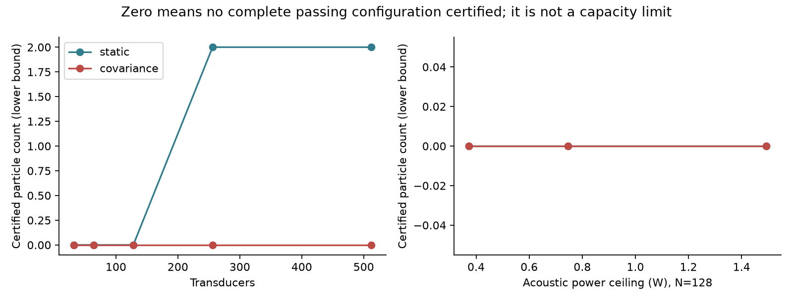
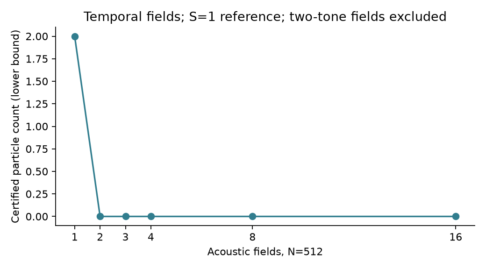
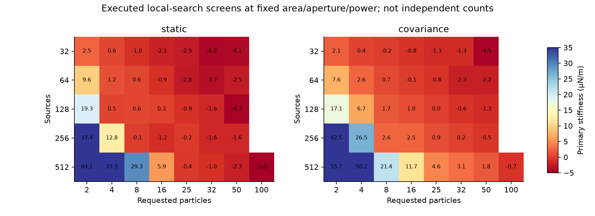
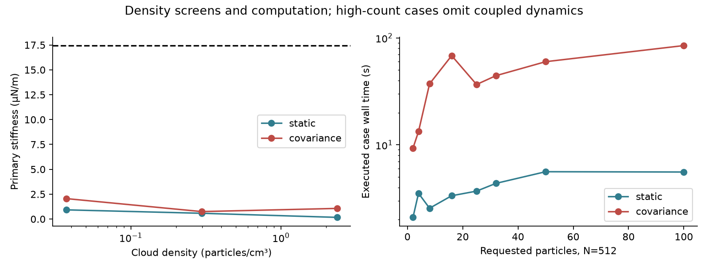
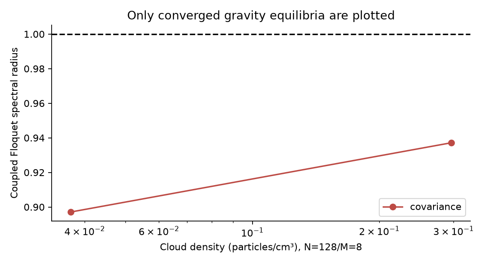

# Phase 3: computational validation of ultrasonic particle control

Research date: 25 November 2026. All values below are executed model calculations, unless explicitly labeled analytical or published. Original Phase-2 deliverables are preserved.

**The study does not establish a temporal-covariance advantage in independently controlled particle count.** Covariance can improve stiffness per modeled acoustic watt and can reach a marginal 16-particle stationary configuration. Other sequences are parametrically unstable. A complete motion contract, numerical convergence, and CPU deadlines are separate acceptance conditions.

The saved study contains 13 fresh legacy reproductions, 28 independent legacy recalculations, 128 new architecture/scaling attempts, 20 fixed-drive convergence calculations, 6 coupled density diagnostics, and 12 motion evidence records (including prechecks and controller replays). 4 records meet every recorded strict condition; the largest qualified configuration has 2 particles. Counts are not hardware records or global optima.

## Part 1: Reproduction

All 13 archived stiffness, equilibrium-error and available Floquet results reproduced exactly in fresh runs from verified source snapshots. This verifies implementation reproducibility, not missing physics. Independent NumPy pressure finite differences and SciPy matrix exponentials import no legacy physics functions.

| Case | Original K µN/m | Fresh K µN/m | Fresh error mm | ρ | Power W | Runtime s |
| --- | --- | --- | --- | --- | --- | --- |
| results_128_ib_2 | 27.52 | 27.52 | 0.3079 | 0.8971 | 0.3732 | 2.894 |
| results_128_static_force_2 | 30.54 | 30.54 | 0.0007799 | 0.8971 | 0.3732 | 7.432 |
| results_128_multifrequency_2 | 26.09 | 26.09 | 0.001035 | — | 0.3732 | 7.029 |
| results_128_time_single_2 | 27.07 | 27.07 | 0.0986 | 0.8971 | 0.3732 | 0.8964 |
| results_128_covariance_2 | 28.48 | 28.48 | 0.000263 | 0.8971 | 0.3732 | 10.14 |
| results_128_support_residual_2 | 13.34 | 13.34 | 0.01882 | 0.8971 | 0.3176 | 5.038 |
| results_512_screen_static_force_8 | 30.9 | 30.9 | 0.00145 | 0.8971 | 1.493 | 6.515 |
| results_512_screen_covariance_8 | 28.87 | 28.87 | 0.001358 | 1.183 | 1.493 | 9.074 |
| results_cycle_1ms_covariance_8 | 15.58 | 15.58 | 0.003451 | 0.9785 | 1.493 | 11.85 |
| results_512_screen_static_force_16 | 8.3 | 8.3 | 0.04047 | 0.8971 | 1.493 | 15.24 |
| results_512_screen_covariance_16 | 15.53 | 15.53 | 0.01468 | 0.8971 | 1.493 | 22.27 |
| results_512_screen_multifrequency_16 | 10.61 | 10.61 | 0.02161 | — | 1.493 | 25.99 |
| results_512_screen_aperiodic_16 | 8.338 | 8.338 | 0.04248 | 0.8971 | 1.493 | 14.74 |

The old eight-particle temporal instability becomes stronger under time refinement at its archived equilibrium:

| Samples/slot | K µN/m | ρ | Gravity residual/weight |
| --- | --- | --- | --- |
| 6 | 28.8675 | 1.1826746 | 1.122e-06 |
| 12 | 29.1672 | 1.250473 | 0.04049 |
| 24 | 29.2716 | 1.2708762 | 0.05461 |
| 48 | 29.3 | 1.2762142 | 0.05844 |

The archived 1-ms sequence reproduces a stable multiplier near 0.979 but insufficient stiffness near 15.58 µN/m. The archived 87.1% sixteen-particle improvement was a stiffness ratio between two insufficient solutions; it never established a count improvement. Refined averaging also moves the gravity-balanced equilibrium, so fixed archived positions cannot be treated as converged physical equilibria.

## Part 2: Simulation Framework

The implementation uses finite baffled-disk Rayleigh quadrature, analytic pressure derivatives through third order, complex pressure/velocity, actual sideband frequencies, coherent beat forces and retarded periodic envelopes. The source response is Hℓ=1/(1−iℓΩτ); Gaussian transition smoothing and unequal cyclic duties shape the command spectrum. Born and Foldy monopole/dipole scattering, full coupled force Jacobians, gravity, finite-Re drag, contact impulses and nonlinear RK4 trajectories are implemented.

With peak phasors exp(−iωt), the governing potential is U=V[f₀|p|²/(4ρc²)−3f₂ρ|v|²/8], v=∇p/(iωρ), and net force is −∇U−mg ẑ. Pressure is Pa; velocity is m/s; U is J; force is N; stiffness is N/m. The negative velocity term and its factors are tested against an analytical standing wave. Full D=−∂F/∂q and state-matrix/Floquet eigenvalues are evaluated, rather than using a positive Laplacian.

The single carrier, IB phase holography, force optimization, singleton sharing, rank-S covariance, coherent support/residual, permanent support and actual two-tone controllers are executable. Adam/autodiff, unequal timing/gauge optimization, ordering search, a small PSD relaxation, force-control conditioning and a discrete matched-geometry/field search were executed. An incremental camera-like controller uses a cached force basis, bounded drive updates and noisy delayed position estimates. Nonlinear flow-Jacobian optimization is a small pilot, not a demonstrated optimum.

The main benchmark fixes 160-mm aperture and gap, a 60-mm cubic workspace, 0.032572 m² emitting area, a 1.492952-W isolated-piston acoustic-power ceiling, 40 kHz carrier, 0.16-ms emitter settling and 0.5-mm-diameter particles of density 30 kg/m³. The main weakest-mode threshold is 17.44103 µN/m, corresponding to 15 Hz for this particle. Source radii for N=32,64,128,256,512 are 18,12.728,9,6.364,4.5 mm. This scaling family requires different physical emitter sizes; ordinary 9-mm transducers do not implement every row.

Power is calculated from isolated baffled-piston radiation resistance, not electrical input or measured array power. Cross-source mutual radiation impedance is absent. Per-source command peaks, spectral power and a conservative band-resistance bound on transient energy are checked. The power ceiling applies to cycle/frame-average power; source drive peaks apply instantaneously. The reported conservative instantaneous power bound can exceed the average ceiling. Steady power ceilings are matched within comparisons; realized power is listed. The supplementary fixed-field attenuation study below matches realized static/covariance power exactly.

Source files: [physics.py](physics.py), [optimization.py](optimization.py), [dynamics.py](dynamics.py), [validation.py](validation.py), [experiments.py](experiments.py), [convergence.py](convergence.py), [convergence_high.py](convergence_high.py), [validate_cases.py](validate_cases.py), [sdp_recovery.py](sdp_recovery.py), [power_match.py](power_match.py), [tests.py](tests.py), [tests_dynamics.py](tests_dynamics.py). See [README.md](README.md) for commands and dependencies.

## Part 3: Experimental Results

The complete numerical inventory appears in Appendix A and [all_experiments.csv](results/all_experiments.csv). Completed case directories retain configuration, seed, geometry, complex coefficients, duties, optimizer history and full coupled arrays when those were computed. The original aborted nonlinear pilot retains its configuration and traceback; its intermediate weights were not preserved. The final runner also snapshots parameters on future execution errors. Screened rejections remain visible. A dash means the metric was not evaluated, not zero.

| Case | N/M/S | K primary µN/m | K coupled µN/m | ρ Floquet | Error mm | Power W | Time s | Outcome |
| --- | --- | --- | --- | --- | --- | --- | --- | --- |
| compare_16_covariance | 512/16/4 | 17.62 | 17.56 | 0.8971 | 0.03861 | 1.493 | 78.44 | stationary_candidate_not_motion_validated |
| compare_16_ib | 512/16/1 | -3.403 | — | — | — | 1.493 | 1.044 | primary_screen_rejection |
| compare_16_multifrequency | 512/16/2 | 14.6 | 14.56 | 0.8971 | 0.08911 | 1.493 | 67.54 | stationary_screen_rejection |
| compare_16_singleton | 512/16/16 | 3.725 | — | — | — | 0.7965 | 15.2 | primary_screen_rejection |
| compare_16_static | 512/16/1 | 10.1 | — | — | — | 1.493 | 5.018 | primary_screen_rejection |
| compare_16_support | 512/16/1 | 2.113 | — | — | — | 1.033 | 6.327 | primary_screen_rejection |
| compare_2_covariance | 512/2/4 | 73.47 | 73.48 | 0.8971 | 0.000679 | 0.8628 | 10.83 | stationary_candidate_not_motion_validated |
| compare_2_ib | 512/2/1 | 107.9 | 111.7 | 0.8971 | 0.3017 | 1.493 | 0.8985 | stationary_screen_rejection |
| compare_2_multifrequency | 512/2/2 | 82.5 | 82.5 | 0.8971 | 0.02209 | 1.324 | 11.52 | stationary_candidate_not_motion_validated |
| compare_2_singleton | 512/2/2 | 135.8 | 135.8 | 2.01 | 0.0468 | 1.493 | 8.999 | stationary_screen_rejection |
| compare_2_static | 512/2/1 | 84.05 | 84.09 | 0.8971 | 0.01752 | 1.186 | 5.676 | stationary_candidate_not_motion_validated |
| compare_2_support | 512/2/1 | 41.28 | 41.28 | 0.8971 | 0.001188 | 0.9348 | 2.879 | stationary_candidate_not_motion_validated |
| compare_8_covariance | 512/8/4 | 31.63 | 31.62 | 1.473 | 0.007643 | 1.493 | 29.82 | stationary_screen_rejection |
| compare_8_ib | 512/8/1 | 21.01 | 21.15 | 0.8971 | 1.233 | 1.493 | 3.424 | stationary_screen_rejection |
| compare_8_multifrequency | 512/8/2 | 29 | 29.01 | 0.8971 | 0.01081 | 1.493 | 20.17 | stationary_candidate_not_motion_validated |
| compare_8_singleton | 512/8/8 | 20.92 | 21.3 | 1.261 | 0.2101 | 1.306 | 16.41 | stationary_screen_rejection |
| compare_8_static | 512/8/1 | 35.77 | 35.78 | 0.8971 | 0.005913 | 1.493 | 2.757 | stationary_candidate_not_motion_validated |
| compare_8_support | 512/8/1 | 11.44 | 11.3 | 0.8971 | 0.1189 | 1.096 | 5.543 | stationary_screen_rejection |

Exactly matched realized power, with each optimized field attenuated to the common lower power and its coupled equilibrium recomputed:

| M | Architecture | Power W | K µN/m | Error mm | ρ |
| --- | --- | --- | --- | --- | --- |
| 2 | static | 0.8628094 | 61.24 | 0.01761 | 0.8971 |
| 2 | covariance | 0.8628094 | 73.48 | 0.000679 | 0.8971 |
| 8 | static | 1.492952 | 35.78 | 0.005913 | 0.8971 |
| 8 | covariance | 1.492952 | 31.62 | 0.007643 | 1.473 |
| 16 | static | 1.492952 | 10.51 | 0.3211 | 0.8971 |
| 16 | covariance | 1.492952 | 17.56 | 0.03861 | 0.8971 |

These are fixed-field sensitivity comparisons; attenuation is not a fresh global optimization at the lower budget. The original 16-particle static primary screen rejected early; this supplement computes its equilibrium and confirms that its stiffness and position remain insufficient.

Motion validations:

| Design | Status | Duration s | Max error mm | Held mm | Min K µN/m | Max CPU ms | Strict count |
| --- | --- | --- | --- | --- | --- | --- | --- |
| compare_2_covariance | compute_rate_failure | 76 | 0.09938 | 0.01 | 71.99 | 1177 | 0 |
| compare_2_covariance | compute_rate_failure | 76 | 0.09938 | 0.01 | 71.99 | 57.74 | 0 |
| compare_2_ib | initial_position_precheck_failure | — | — | — | — | — | 0 |
| compare_2_multifrequency | compute_rate_failure | 76 | 0.07721 | 0.03864 | 64.87 | 84.26 | 0 |
| compare_2_multifrequency | strict_pass | 76 | 0.07721 | 0.03864 | 64.87 | 23.2 | 2 |
| compare_2_singleton | periodic_instability_precheck_failure | — | — | — | — | — | 0 |
| compare_2_static | compute_rate_failure | 76 | 0.09857 | 0.03025 | 76.73 | 67.85 | 0 |
| compare_2_static | strict_pass | 76 | 0.09857 | 0.03025 | 76.73 | 37.08 | 2 |
| compare_2_static | compute_rate_failure | 76 | 0.09856 | 0.03024 | 76.73 | 79.47 | 0 |
| compare_2_support | strict_pass | 76 | 0.0945 | 0.004296 | 26.04 | 41.74 | 2 |
| scale_N128_M2_static | moving_trap_stiffness_failure | 33.45 | 0.07269 | 0.01289 | 17.17 | 14.99 | 0 |
| scale_N256_M2_static | strict_pass | 76 | 0.08538 | 0.007968 | 28.96 | 29.72 | 2 |

The motion protocol commands every particle by ±0.25 and ±1 mm in X/Y/Z, returns to baseline, and moves distinct particles simultaneously. Cubic ramps last 0.4 s for 0.25 mm and 2 s for 1 mm. Their maximum speeds are 0.938 and 0.750 mm/s. Two-particle protocols run 76 simulated seconds. The 20-Hz command rate does not mean 20-Hz full-amplitude motion. Position error is the maximum within each integration frame, not only a favorable frame endpoint. Camera noise is 10 µm rms per coordinate with 20-ms delay in the standard test.

The first motion harness included offline stiffness certification and acoustic-polynomial transfer generation in its deadline. Those are verification/simulation oracles, rather than emitted-drive control. Its compute-rate failures remain preserved. The separate replay times camera processing, force correction and actual spectral packet generation, checks every control coordinate against the saved trajectory, and combines a passing replay only with an already completed motion contract. Integration, calibration, global optimization, oracle checks, surrogate construction and JIT warm-up remain offline. These results do not certify an OS hard real-time guarantee or real camera/FPGA transport.

## Part 4: Temporal Covariance Analysis

| Case | N/M/S | K primary µN/m | K coupled µN/m | ρ Floquet | Error mm | Power W | Time s | Outcome |
| --- | --- | --- | --- | --- | --- | --- | --- | --- |
| control_jacobian | 128/2/1 | 20.21 | 20.2 | 0.8971 | 0.00873 | 1.493 | 6.266 | stationary_candidate_not_motion_validated |
| cycle_0.0010 | 512/2/4 | 61.19 | 61.19 | 0.9785 | 0.0008078 | 0.722 | 15.95 | stationary_candidate_not_motion_validated |
| cycle_0.0025 | 512/2/4 | 68.48 | 68.48 | 0.9471 | 0.0001279 | 0.7902 | 14 | stationary_candidate_not_motion_validated |
| cycle_0.0100 | 512/2/4 | 83.05 | 83.04 | 7.507 | 0.0003567 | 0.9409 | 17.79 | stationary_screen_rejection |
| joint_floquet | 128/2/4 | 18.29 | 18.28 | 0.8971 | 0.007471 | 1.493 | 14.13 | stationary_candidate_not_motion_validated |
| nonlinear_floquet | 64/2/2 | — | — | — | — | — | 74.44 | execution_error |
| permanent_support | 512/2/4 | 51.29 | 51.22 | 1.007 | 0.0153 | 0.7633 | 18.52 | stationary_screen_rejection |
| sdp32 | 32/2/1 | 2.451 | — | — | — | 1.493 | 8.806 | primary_screen_rejection |
| slots_16 | 512/2/16 | 56.16 | 56.16 | 0.8971 | 0.0003317 | 0.6666 | 17.67 | stationary_candidate_not_motion_validated |
| slots_2 | 512/2/2 | 43.31 | 43.32 | 1.845 | 0.001173 | 0.889 | 17.4 | stationary_screen_rejection |
| slots_3 | 512/2/3 | 78.8 | 78.79 | 3.02 | 0.001304 | 0.925 | 14.98 | stationary_screen_rejection |
| slots_4 | 512/2/4 | 73.47 | 73.48 | 0.8971 | 0.000679 | 0.8628 | 14.07 | stationary_candidate_not_motion_validated |
| slots_8 | 512/2/8 | 70.75 | 70.75 | 0.9046 | 0.0001819 | 0.8424 | 15.82 | stationary_candidate_not_motion_validated |
| smooth_0.000000 | 512/2/4 | 52.41 | 52.42 | 0.8971 | 0.00158 | 0.9815 | 19.14 | stationary_candidate_not_motion_validated |
| smooth_0.000040 | 512/2/4 | 70 | 70 | 0.8971 | 0.0007218 | 0.8181 | 17.81 | stationary_candidate_not_motion_validated |
| smooth_0.000160 | 512/2/4 | 70.67 | 70.66 | 0.8971 | 0.0003138 | 0.8421 | 18.54 | stationary_candidate_not_motion_validated |
| timing_floquet | 512/2/4 | 72.49 | 72.49 | 0.8971 | 0.001528 | 0.863 | 18.4 | stationary_candidate_not_motion_validated |

Two and three fields produce high averaged stiffness but unstable periodic mechanics in the tested two-particle initializations. Four, eight and sixteen fields can be locally stable. More fields do not monotonically improve stiffness. Filtering makes short slots increasingly redundant, while coherent transitions and phase gauges alter both force and mechanical modulation.

Unequal duties and gauges are optimized jointly with fields in every covariance run. The timing-only and ordering studies hold the mode family while adjusting its schedule; ordering rows are saved in case.json. Direct Floquet penalties constrain the complete coupled linearized sequence. The initial nonlinear-gradient pilot failed with NaNs from a second derivative of velocity norm at zero. A negligible velocity regularizer corrected this; the repeated two-iteration pilot executed, but did not meet the main stiffness threshold. The failed attempt remains saved.

Nonlinear shooting of the two-particle covariance sequence gives ρ=0.89346283 at 64 steps/cycle and 0.89346297 at 128, with approximately 0.007081-mm periodic position excursion. Both shooting closures converged. The static result gives ρ≈0.897077805 at both resolutions. The finite-amplitude orbit differs from a Floquet calculation centered at a mean equilibrium; both are useful and neither alone establishes finite independent motion.

The sixteen-particle candidate receives additional fixed-drive checks:

| Harmonics | Samples | Disk refinement | FD µm | K µN/m | ρ | Gravity residual/weight | Power W |
| --- | --- | --- | --- | --- | --- | --- | --- |
| 8 | 64 | 1 | 25 | 17.5635 | 0.89708931 | 4.061e-08 | 1.4929517 |
| 8 | 128 | 1 | 25 | 17.5635 | 0.89708931 | 4.061e-08 | 1.4929517 |
| 16 | 128 | 1 | 25 | 17.57321 | 0.89708941 | 0.001865 | 1.4945904 |
| 8 | 128 | 2 | 25 | 17.68406 | 0.89708925 | 0.01163 | 1.4929517 |
| 8 | 128 | 1 | 12.5 | 17.56392 | 0.89708933 | 4.061e-08 | 1.4929517 |

Retaining ±16 harmonics increases modeled power slightly beyond the original ceiling when the original fields are held fixed. That row is a convergence sensitivity, not a fair passing configuration. Quadrature refinement also changes the gravity residual at the old equilibrium. Reprojection, rebalancing and finite-motion validation would be required before accepting this marginal candidate.

## Part 5: New Discoveries

The useful improvement is a larger feasible force-design space, not a universal frequency or slot multiplier. At exactly 0.862809447 W in the two-particle fixed-field comparison, covariance reaches 73.475 µN/m against 61.245 µN/m for static control: approximately 20.0% more stiffness. This is an energy/stiffness observation, not an independent-count gain. Its two-particle nonlinear motion passes the 76-s trajectory contract, but the identical controller replay has a 57.74-ms maximum update against the strict 50-ms deadline. At eight particles the covariance sequence is weaker and unstable. At sixteen particles it raises stationary stiffness to 17.56 µN/m, but has not passed full motion or robustness.

Coherent support-residual control also qualifies two particles at N=512. It uses 71.272 J over the same 76-s protocol against 92.057 J for the unstructured static force design: 22.6% lower integrated modeled acoustic energy. Held drift is 0.00430 mm rather than 0.03025 mm. Its weakest moving stiffness is lower, 26.04 versus 76.73 µN/m, but both exceed the benchmark. A shared coherent support field therefore does not inherently prevent local independent motion. This remains one target cloud, one idealized material and one slow motion class.

The PSD relaxation has a meaningful positive control: under the separate 5-Hz threshold, N=32 gives an ideal covariance at 0.603745 W with gravity residual approximately 2.7×10⁻¹³ of weight. Its recovered finite sequences lose force balance and stiffness when rank truncation, source peaks and filtering are enforced. Refinement improves their fields but does not erase the residual. This directly demonstrates why an ideal PSD solution cannot be advertised as a waveform certificate.

| Stage | Rank | K µN/m | Gravity residual/weight | Power W | ρ |
| --- | --- | --- | --- | --- | --- |
| ideal_covariance | full | 1.938 | 2.692e-13 | 0.6037 | — |
| projected | 1 | 1.384 | 0.6196 | 0.4566 | 0.8971 |
| optimized | 1 | 4.252 | 0.102 | 1.493 | 0.8971 |
| projected | 2 | 1.38 | 0.5049 | 0.4799 | 0.8971 |
| optimized | 2 | 3.972 | 0.06395 | 1.493 | 0.8971 |
| projected | 4 | 0.8777 | 0.6962 | 0.3486 | 0.9196 |
| optimized | 4 | 3.878 | 0.07644 | 1.493 | 0.8971 |
| projected | 8 | 0.3687 | 0.9272 | 0.1908 | 0.9759 |
| optimized | 8 | 3.85 | 0.07934 | 1.493 | 0.8971 |

The main 15-Hz SDP returned infeasible_inaccurate; that status is not a rigorous impossibility proof. The matched jitter/field searches changed stiffness modestly, without an independence advantage. Other geometry-seed cases also changed target clouds and are reported as robustness samples, not fair geometry-only improvements. Control-Jacobian optimization was executed as a small pilot; rank and conditioning are necessary, not sufficient, for finite control.

## Part 6: Scaling Results

N=32,64,128,256,512 and M=2,4,8,16,25,32,50 were attempted for both static and four-field covariance control. M=100 was attempted at N=512. Emitting area, aperture, workspace, material, source peak and power ceiling are fixed. Targets are identical between architectures and source counts for each M; different M values use different seeded clouds, not nested subsets.

The displayed count is the largest fully certified count among executed tests, a lower bound. Zero means this study has not certified a complete configuration at that setting. It does not mean that no configuration can work. Stationary candidates are never included. Power-sweep points without full motion remain uncertified. There is no defensible empirical capacity curve beyond these lower bounds.

| Case | Density /cm³ | Root converged | Position error mm | K coupled µN/m | ρ | log(ρ)/T per s |
| --- | --- | --- | --- | --- | --- | --- |
| density_0.25_static | 2.37 | False | 1.069 | -4.956 | 1.179 | 33.02 |
| density_0.25_covariance | 2.37 | False | 1.413 | -0.9987 | 1.048 | 9.442 |
| density_0.5_static | 0.2963 | False | 1.598 | -0.3494 | 1.019 | 3.769 |
| density_0.5_covariance | 0.2963 | True | 1.156 | 0.7733 | 0.9372 | -12.98 |
| density_1.0_static | 0.03704 | False | 0.8126 | 0.2155 | 0.9866 | -2.693 |
| density_1.0_covariance | 0.03704 | True | 0.551 | 1.26 | 0.8971 | -21.72 |

Locally stable linearized periodic dynamics can coexist with insufficient stiffness or target accuracy. These density rows are diagnostics at mean gravity equilibria; no eight-particle nonlinear orbit or retention was certified. Nonconverged roots are retained in the table but not plotted as equilibrium stability certificates. Different cycle lengths must be compared using log(ρ)/T, not raw per-cycle multipliers.

Large clouds receive an uncoupled primary-force/stiffness screen. Their coupled Floquet, camera motion and 60-s retention values are explicitly absent. Cases over sixteen particles use fewer optimization iterations; shortfall in a local search is not an upper bound. Some sixteen-particle results change materially between 80 and 180 iterations, showing that optimizer effort is itself a confound. The largest covariance source-jet cache estimate is 531.25 MiB (557.1 MB), before runtime overhead; the executed 100-particle case is a screen rather than full trajectory certification. No GPU was available; Torch ran on CPU with a CPU-compatible dynamics path.

## Part 7: Best Architecture

**Select calibrated single-carrier force-based holography with cached incremental feedback as the first hardware baseline.** It qualifies two particles with 256 transducers, the smallest source count qualified in the executed main-benchmark tests. That 76-s trajectory gives 0.08538-mm maximum target error, 0.00797-mm held drift, 28.96-µN/m minimum moving stiffness and 29.72-ms maximum controller computation. N=128 passes the initial stationary screen but fails during a 1-mm move when stiffness falls below threshold; this is a configuration failure, not a universal minimum-source theorem.

At N=512, coherent support-residual control is the more economical tested single-carrier configuration by modeled energy and held drift, with less stiffness margin. Two-tone control also qualifies two particles after an identical-command timing replay; it uses more energy than these single-carrier examples and does not double the count. Temporal covariance remains a follow-up hypothesis for stiffness per watt and many-particle stationary feasibility. No tested architecture establishes a qualified high-density count advantage.

The recommendation is provisional about capacity: only complete strict runs may establish a count. Conventional IB here is an explicit phase-holography baseline with gravity-induced positioning error. A simple focus-offset compensation was also attempted and did not converge robustly; this is not proof against stronger conventional controllers. Static force control has amplitude/phase freedom, whereas IB is phase-only. Accordingly the study does not isolate every gain to the force objective alone.

## Part 8: Physical Prototype

The smallest useful mechanism experiment is an opposed 32-channel array (two 4×4 faces), two matched foam particles, a measured single-carrier transfer matrix, and calibrated phase-step response. Use a separate slow benchmark, initially 5 Hz weakest-mode frequency; this is not the main 15-Hz result. Ordinary small emitters have far less emitting area than the fixed-area N=32 scaling model, so model the actual hardware and measure single-trap authority before attempting two particles. If insufficient, increase to two 8×8 faces (128 channels) while preserving the same experimental comparison.

| Component category | Approximate planning allowance (USD) |
| --- | --- |
| 32 rated air-ultrasound emitters and mounts | 60–180 |
| Synchronized phase/amplitude drivers, FPGA or timing MCU, protected supply | 150–500 |
| Two calibrated high-frame-rate cameras and illumination | 250–800 |
| Phase-capable ultrasound probe/interface or rented measurement setup | 250–1,000 |
| Beads, alignment fixtures, catch tray and enclosure materials | 80–250 |
| Total with reused oscilloscope/computer | 790–2,730 |

These are planning estimates, not verified supplier quotes. Borrowing measurement equipment can lower outlay; higher-channel hardware and commercial probe calibration can exceed these ranges. The acoustic watt values in the simulation do not specify a supply rating.

First measure pressure/phase transfers and complex emitter step response. Compare one static field, two/four jointly optimized fields and singleton sharing at identical measured power and target positions. Sweep sequence period while measuring micromotion and ringdown stiffness. Use high-rate particle observations for the relevant fast modes; 20-Hz control images alone cannot detect every unstable carrier-envelope motion.

Success requires repeatable signed and simultaneous 0.25/1-mm moves, held and moving errors ≤0.10 mm, ≥60-s retention, measured stiffness meeting the declared prototype threshold, and measured end-to-end updates ≥20 Hz. A temporal improvement must survive measured source filtering and equal-power comparison. Failure includes any positive-average sequence with growing micromotion, drop, identity loss, stiffness shortfall or deadline misses. Begin with rigid perturbation objects and a particle catch tray; ultrasound exposure and audible by-products need calibrated measurement before human access.

## Part 9: Remaining Research

1. Complete refined finite-motion tests of the sixteen-particle covariance candidate; its stationary margin is too small for a robustness claim.
2. Optimize capture basins, displacement authority and scheduling jointly, across multiple independent seeded clouds and stronger restarts.
3. Replace isolated-piston power with measured mutual radiation impedance and electrical losses.
4. Add streaming, viscothermal/finite-size and absorptive forces, source variation and boundaries; validate them against the prototype.
5. Benchmark worst-case online latency on a dedicated controller and include camera/transport/FPGA delay.
6. Determine whether a PSD initializer plus stability-aware field refinement can improve complete passing count rather than only stiffness.
7. Test disturbance recovery, source calibration uncertainty, camera occlusion/identity loss and longer retention. The current tests do not establish those capabilities.

Model limits: homogeneous unbounded air, ideal baffled emitters, Rayleigh particle response, approximate Born/Foldy scattering forces, finite polynomial domains and a narrowband approximation for between-frame envelope derivatives. A surrogate-domain exit is a validation failure, not automatically a physical escape. Loading, independent optical color, enclosure scattering and hand interaction are outside the executed study. No result establishes physical display capacity.

## Appendix A: Every new executed architecture/scaling attempt

| Case | N/M/S | K primary µN/m | K coupled µN/m | ρ Floquet | Error mm | Power W | Time s | Outcome |
| --- | --- | --- | --- | --- | --- | --- | --- | --- |
| compare_16_covariance | 512/16/4 | 17.62 | 17.56 | 0.8971 | 0.03861 | 1.493 | 78.44 | stationary_candidate_not_motion_validated |
| compare_16_ib | 512/16/1 | -3.403 | — | — | — | 1.493 | 1.044 | primary_screen_rejection |
| compare_16_multifrequency | 512/16/2 | 14.6 | 14.56 | 0.8971 | 0.08911 | 1.493 | 67.54 | stationary_screen_rejection |
| compare_16_singleton | 512/16/16 | 3.725 | — | — | — | 0.7965 | 15.2 | primary_screen_rejection |
| compare_16_static | 512/16/1 | 10.1 | — | — | — | 1.493 | 5.018 | primary_screen_rejection |
| compare_16_support | 512/16/1 | 2.113 | — | — | — | 1.033 | 6.327 | primary_screen_rejection |
| compare_2_covariance | 512/2/4 | 73.47 | 73.48 | 0.8971 | 0.000679 | 0.8628 | 10.83 | stationary_candidate_not_motion_validated |
| compare_2_ib | 512/2/1 | 107.9 | 111.7 | 0.8971 | 0.3017 | 1.493 | 0.8985 | stationary_screen_rejection |
| compare_2_multifrequency | 512/2/2 | 82.5 | 82.5 | 0.8971 | 0.02209 | 1.324 | 11.52 | stationary_candidate_not_motion_validated |
| compare_2_singleton | 512/2/2 | 135.8 | 135.8 | 2.01 | 0.0468 | 1.493 | 8.999 | stationary_screen_rejection |
| compare_2_static | 512/2/1 | 84.05 | 84.09 | 0.8971 | 0.01752 | 1.186 | 5.676 | stationary_candidate_not_motion_validated |
| compare_2_support | 512/2/1 | 41.28 | 41.28 | 0.8971 | 0.001188 | 0.9348 | 2.879 | stationary_candidate_not_motion_validated |
| compare_8_covariance | 512/8/4 | 31.63 | 31.62 | 1.473 | 0.007643 | 1.493 | 29.82 | stationary_screen_rejection |
| compare_8_ib | 512/8/1 | 21.01 | 21.15 | 0.8971 | 1.233 | 1.493 | 3.424 | stationary_screen_rejection |
| compare_8_multifrequency | 512/8/2 | 29 | 29.01 | 0.8971 | 0.01081 | 1.493 | 20.17 | stationary_candidate_not_motion_validated |
| compare_8_singleton | 512/8/8 | 20.92 | 21.3 | 1.261 | 0.2101 | 1.306 | 16.41 | stationary_screen_rejection |
| compare_8_static | 512/8/1 | 35.77 | 35.78 | 0.8971 | 0.005913 | 1.493 | 2.757 | stationary_candidate_not_motion_validated |
| compare_8_support | 512/8/1 | 11.44 | 11.3 | 0.8971 | 0.1189 | 1.096 | 5.543 | stationary_screen_rejection |
| control_jacobian | 128/2/1 | 20.21 | 20.2 | 0.8971 | 0.00873 | 1.493 | 6.266 | stationary_candidate_not_motion_validated |
| cycle_0.0010 | 512/2/4 | 61.19 | 61.19 | 0.9785 | 0.0008078 | 0.722 | 15.95 | stationary_candidate_not_motion_validated |
| cycle_0.0025 | 512/2/4 | 68.48 | 68.48 | 0.9471 | 0.0001279 | 0.7902 | 14 | stationary_candidate_not_motion_validated |
| cycle_0.0100 | 512/2/4 | 83.05 | 83.04 | 7.507 | 0.0003567 | 0.9409 | 17.79 | stationary_screen_rejection |
| density_0.25_covariance | 128/8/4 | 1.067 | — | — | — | 1.493 | 9.129 | primary_screen_rejection |
| density_0.25_static | 128/8/1 | 0.1672 | — | — | — | 1.493 | 2.04 | primary_screen_rejection |
| density_0.5_covariance | 128/8/4 | 0.7498 | — | — | — | 1.492 | 8.401 | primary_screen_rejection |
| density_0.5_static | 128/8/1 | 0.5789 | — | — | — | 1.493 | 1.65 | primary_screen_rejection |
| density_1.0_covariance | 128/8/4 | 2.056 | — | — | — | 1.493 | 9.555 | primary_screen_rejection |
| density_1.0_static | 128/8/1 | 0.923 | — | — | — | 1.493 | 3.131 | primary_screen_rejection |
| geometry_7 | 128/2/1 | 20.16 | 20.16 | 0.8971 | 0.01155 | 1.493 | 2.357 | stationary_candidate_not_motion_validated |
| geometry_8 | 128/2/1 | 21.64 | 21.64 | 0.8971 | 0.003585 | 1.493 | 2.278 | stationary_candidate_not_motion_validated |
| geometry_9 | 128/2/1 | 19.2 | 19.19 | 0.8971 | 0.02398 | 1.493 | 2.17 | stationary_candidate_not_motion_validated |
| geometry_matched_7 | 128/2/1 | 20.16 | 20.16 | 0.8971 | 0.01155 | 1.493 | 2.265 | stationary_candidate_not_motion_validated |
| geometry_matched_8 | 128/2/1 | 20.26 | 20.26 | 0.8971 | 0.009962 | 1.493 | 1.961 | stationary_candidate_not_motion_validated |
| geometry_matched_9 | 128/2/1 | 20.33 | 20.32 | 0.8971 | 0.009962 | 1.493 | 1.879 | stationary_candidate_not_motion_validated |
| gravity_compensated_ib2 | 512/2/1 | 106.9 | 115.2 | 0.8971 | 0.5092 | 1.493 | 9.493 | stationary_screen_rejection |
| joint_floquet | 128/2/4 | 18.29 | 18.28 | 0.8971 | 0.007471 | 1.493 | 14.13 | stationary_candidate_not_motion_validated |
| nonlinear_floquet | 64/2/2 | — | — | — | — | — | 74.44 | execution_error |
| nonlinear_floquet_regularized | 64/2/2 | 8.904 | — | — | — | 1.493 | 100.3 | primary_screen_rejection |
| permanent_support | 512/2/4 | 51.29 | 51.22 | 1.007 | 0.0153 | 0.7633 | 18.52 | stationary_screen_rejection |
| power_0.25_covariance | 128/2/4 | 4.237 | — | — | — | 0.3732 | 6.008 | primary_screen_rejection |
| power_0.25_static | 128/2/1 | 5.256 | — | — | — | 0.3732 | 4.738 | primary_screen_rejection |
| power_0.5_covariance | 128/2/4 | 10.58 | — | — | — | 0.7465 | 4.516 | primary_screen_rejection |
| power_0.5_static | 128/2/1 | 11.72 | 11.72 | 0.8971 | 0.02849 | 0.7465 | 1.993 | stationary_screen_rejection |
| power_1.0_covariance | 128/2/4 | 17.79 | 17.79 | 0.8971 | 0.006613 | 1.493 | 9.695 | stationary_candidate_not_motion_validated |
| power_1.0_static | 128/2/1 | 20.21 | 20.21 | 0.8971 | 0.009259 | 1.493 | 1.532 | stationary_candidate_not_motion_validated |
| scale_N128_M16_covariance | 128/16/4 | 0.9624 | — | — | — | 1.491 | 12.09 | primary_screen_rejection |
| scale_N128_M16_static | 128/16/1 | 0.2764 | — | — | — | 1.493 | 1.613 | primary_screen_rejection |
| scale_N128_M25_covariance | 128/25/4 | 0.03664 | — | — | — | 1.378 | 15.14 | primary_screen_rejection |
| scale_N128_M25_static | 128/25/1 | -0.91 | — | — | — | 1.493 | 1.438 | primary_screen_rejection |
| scale_N128_M2_covariance | 128/2/4 | 17.07 | 17.07 | 0.8971 | 0.008507 | 1.49 | 7.465 | stationary_screen_rejection |
| scale_N128_M2_static | 128/2/1 | 19.26 | 19.26 | 0.8971 | 0.01304 | 1.493 | 1.659 | stationary_candidate_not_motion_validated |
| scale_N128_M32_covariance | 128/32/4 | -0.6465 | — | — | — | 1.489 | 20.28 | primary_screen_rejection |
| scale_N128_M32_static | 128/32/1 | -1.589 | — | — | — | 1.493 | 1.588 | primary_screen_rejection |
| scale_N128_M4_covariance | 128/4/4 | 6.682 | — | — | — | 1.492 | 7.199 | primary_screen_rejection |
| scale_N128_M4_static | 128/4/1 | 0.4517 | — | — | — | 1.493 | 1.818 | primary_screen_rejection |
| scale_N128_M50_covariance | 128/50/4 | -1.262 | — | — | — | 1.493 | 33.32 | primary_screen_rejection |
| scale_N128_M50_static | 128/50/1 | -4.653 | — | — | — | 1.493 | 2.738 | primary_screen_rejection |
| scale_N128_M8_covariance | 128/8/4 | 1.699 | — | — | — | 1.493 | 11.18 | primary_screen_rejection |
| scale_N128_M8_static | 128/8/1 | 0.6179 | — | — | — | 1.493 | 2.067 | primary_screen_rejection |
| scale_N256_M16_covariance | 256/16/4 | 2.458 | — | — | — | 1.493 | 15.86 | primary_screen_rejection |
| scale_N256_M16_static | 256/16/1 | -1.152 | — | — | — | 1.493 | 1.508 | primary_screen_rejection |
| scale_N256_M25_covariance | 256/25/4 | 0.9426 | — | — | — | 1.327 | 20.48 | primary_screen_rejection |
| scale_N256_M25_static | 256/25/1 | -0.2363 | — | — | — | 1.289 | 1.964 | primary_screen_rejection |
| scale_N256_M2_covariance | 256/2/4 | 42.54 | 42.54 | 0.9623 | 0.0007654 | 1.486 | 8.553 | stationary_candidate_not_motion_validated |
| scale_N256_M2_static | 256/2/1 | 37.38 | 37.34 | 0.8971 | 0.005975 | 1.45 | 1.82 | stationary_candidate_not_motion_validated |
| scale_N256_M32_covariance | 256/32/4 | 0.2132 | — | — | — | 1.217 | 24.65 | primary_screen_rejection |
| scale_N256_M32_static | 256/32/1 | -1.633 | — | — | — | 1.174 | 3.145 | primary_screen_rejection |
| scale_N256_M4_covariance | 256/4/4 | 26.52 | 26.51 | 1.892 | 0.007038 | 1.493 | 13.44 | stationary_screen_rejection |
| scale_N256_M4_static | 256/4/1 | 12.83 | 12.87 | 0.8971 | 0.1904 | 1.487 | 2.071 | stationary_screen_rejection |
| scale_N256_M50_covariance | 256/50/4 | -0.5035 | — | — | — | 1.184 | 35.46 | primary_screen_rejection |
| scale_N256_M50_static | 256/50/1 | -1.571 | — | — | — | 1.094 | 3.144 | primary_screen_rejection |
| scale_N256_M8_covariance | 256/8/4 | 2.562 | — | — | — | 1.493 | 6.951 | primary_screen_rejection |
| scale_N256_M8_static | 256/8/1 | -0.09691 | — | — | — | 1.483 | 1.863 | primary_screen_rejection |
| scale_N32_M16_covariance | 32/16/4 | -0.7721 | — | — | — | 1.493 | 12.05 | primary_screen_rejection |
| scale_N32_M16_static | 32/16/1 | -2.137 | — | — | — | 1.493 | 2.176 | primary_screen_rejection |
| scale_N32_M25_covariance | 32/25/4 | -1.284 | — | — | — | 1.49 | 22.43 | primary_screen_rejection |
| scale_N32_M25_static | 32/25/1 | -2.501 | — | — | — | 1.493 | 2.098 | primary_screen_rejection |
| scale_N32_M2_covariance | 32/2/4 | 2.082 | — | — | — | 1.493 | 4.704 | primary_screen_rejection |
| scale_N32_M2_static | 32/2/1 | 2.451 | — | — | — | 1.493 | 4.775 | primary_screen_rejection |
| scale_N32_M32_covariance | 32/32/4 | -1.333 | — | — | — | 1.489 | 26.3 | primary_screen_rejection |
| scale_N32_M32_static | 32/32/1 | -4.249 | — | — | — | 1.483 | 2.113 | primary_screen_rejection |
| scale_N32_M4_covariance | 32/4/4 | 0.4015 | — | — | — | 1.493 | 5.507 | primary_screen_rejection |
| scale_N32_M4_static | 32/4/1 | 0.5832 | — | — | — | 1.493 | 1.292 | primary_screen_rejection |
| scale_N32_M50_covariance | 32/50/4 | -4.486 | — | — | — | 1.479 | 38.01 | primary_screen_rejection |
| scale_N32_M50_static | 32/50/1 | -4.061 | — | — | — | 1.376 | 3.181 | primary_screen_rejection |
| scale_N32_M8_covariance | 32/8/4 | -0.1526 | — | — | — | 1.493 | 8.576 | primary_screen_rejection |
| scale_N32_M8_static | 32/8/1 | -0.993 | — | — | — | 1.493 | 1.346 | primary_screen_rejection |
| scale_N512_M100_covariance | 512/100/4 | -0.7077 | — | — | — | 1.236 | 84.73 | primary_screen_rejection |
| scale_N512_M100_static | 512/100/1 | -5.044 | — | — | — | 0.9392 | 5.573 | primary_screen_rejection |
| scale_N512_M16_covariance | 512/16/4 | 11.68 | 11.64 | 0.8971 | 0.1277 | 1.492 | 68.19 | stationary_screen_rejection |
| scale_N512_M16_static | 512/16/1 | 5.874 | — | — | — | 1.493 | 3.346 | primary_screen_rejection |
| scale_N512_M25_covariance | 512/25/4 | 4.601 | — | — | — | 1.397 | 36.66 | primary_screen_rejection |
| scale_N512_M25_static | 512/25/1 | -0.4282 | — | — | — | 1.284 | 3.695 | primary_screen_rejection |
| scale_N512_M2_covariance | 512/2/4 | 55.66 | 55.7 | 0.8971 | 0.007434 | 0.9687 | 9.316 | stationary_candidate_not_motion_validated |
| scale_N512_M2_static | 512/2/1 | 84.05 | 84.09 | 0.8971 | 0.01752 | 1.186 | 2.1 | stationary_candidate_not_motion_validated |
| scale_N512_M32_covariance | 512/32/4 | 3.133 | — | — | — | 1.415 | 44.32 | primary_screen_rejection |
| scale_N512_M32_static | 512/32/1 | -1.007 | — | — | — | 1.229 | 4.365 | primary_screen_rejection |
| scale_N512_M4_covariance | 512/4/4 | 50.23 | 50.23 | 3.397 | 0.001286 | 1.173 | 13.33 | stationary_screen_rejection |
| scale_N512_M4_static | 512/4/1 | 37.28 | 37.3 | 0.8971 | 0.00485 | 1.277 | 3.525 | stationary_candidate_not_motion_validated |
| scale_N512_M50_covariance | 512/50/4 | 1.849 | — | — | — | 1.29 | 59.9 | primary_screen_rejection |
| scale_N512_M50_static | 512/50/1 | -2.34 | — | — | — | 0.908 | 5.611 | primary_screen_rejection |
| scale_N512_M8_covariance | 512/8/4 | 21.43 | 21.43 | 1.809 | 0.02791 | 1.493 | 37.21 | stationary_screen_rejection |
| scale_N512_M8_static | 512/8/1 | 29.26 | 29.27 | 0.8971 | 0.0117 | 1.493 | 2.557 | stationary_candidate_not_motion_validated |
| scale_N64_M16_covariance | 64/16/4 | -0.05635 | — | — | — | 1.493 | 17.42 | primary_screen_rejection |
| scale_N64_M16_static | 64/16/1 | -0.9054 | — | — | — | 1.493 | 2.433 | primary_screen_rejection |
| scale_N64_M25_covariance | 64/25/4 | -0.7674 | — | — | — | 1.491 | 19.91 | primary_screen_rejection |
| scale_N64_M25_static | 64/25/1 | -2.79 | — | — | — | 1.493 | 2.241 | primary_screen_rejection |
| scale_N64_M2_covariance | 64/2/4 | 7.572 | — | — | — | 1.492 | 5.364 | primary_screen_rejection |
| scale_N64_M2_static | 64/2/1 | 9.608 | — | — | — | 1.493 | 1.488 | primary_screen_rejection |
| scale_N64_M32_covariance | 64/32/4 | -2.339 | — | — | — | 1.491 | 26.48 | primary_screen_rejection |
| scale_N64_M32_static | 64/32/1 | -3.736 | — | — | — | 1.493 | 2.244 | primary_screen_rejection |
| scale_N64_M4_covariance | 64/4/4 | 2.603 | — | — | — | 1.493 | 6.715 | primary_screen_rejection |
| scale_N64_M4_static | 64/4/1 | 1.194 | — | — | — | 1.493 | 1.949 | primary_screen_rejection |
| scale_N64_M50_covariance | 64/50/4 | -2.248 | — | — | — | 1.493 | 37.11 | primary_screen_rejection |
| scale_N64_M50_static | 64/50/1 | -2.536 | — | — | — | 1.493 | 3.076 | primary_screen_rejection |
| scale_N64_M8_covariance | 64/8/4 | 0.708 | — | — | — | 1.492 | 10.05 | primary_screen_rejection |
| scale_N64_M8_static | 64/8/1 | 0.5785 | — | — | — | 1.493 | 2.1 | primary_screen_rejection |
| sdp32 | 32/2/1 | 2.451 | — | — | — | 1.493 | 8.806 | primary_screen_rejection |
| sdp32_slow | 32/2/1 | 3.851 | 3.435 | 0.8971 | 0.7232 | 1.493 | 11.99 | stationary_screen_rejection |
| slots_16 | 512/2/16 | 56.16 | 56.16 | 0.8971 | 0.0003317 | 0.6666 | 17.67 | stationary_candidate_not_motion_validated |
| slots_2 | 512/2/2 | 43.31 | 43.32 | 1.845 | 0.001173 | 0.889 | 17.4 | stationary_screen_rejection |
| slots_3 | 512/2/3 | 78.8 | 78.79 | 3.02 | 0.001304 | 0.925 | 14.98 | stationary_screen_rejection |
| slots_4 | 512/2/4 | 73.47 | 73.48 | 0.8971 | 0.000679 | 0.8628 | 14.07 | stationary_candidate_not_motion_validated |
| slots_8 | 512/2/8 | 70.75 | 70.75 | 0.9046 | 0.0001819 | 0.8424 | 15.82 | stationary_candidate_not_motion_validated |
| smooth_0.000000 | 512/2/4 | 52.41 | 52.42 | 0.8971 | 0.00158 | 0.9815 | 19.14 | stationary_candidate_not_motion_validated |
| smooth_0.000040 | 512/2/4 | 70 | 70 | 0.8971 | 0.0007218 | 0.8181 | 17.81 | stationary_candidate_not_motion_validated |
| smooth_0.000160 | 512/2/4 | 70.67 | 70.66 | 0.8971 | 0.0003138 | 0.8421 | 18.54 | stationary_candidate_not_motion_validated |
| timing_floquet | 512/2/4 | 72.49 | 72.49 | 0.8971 | 0.001528 | 0.863 | 18.4 | stationary_candidate_not_motion_validated |

## Appendix B: Numerical convergence inventory

All fixed-drive two-particle rows are retained in [convergence/results.json](results/convergence/results.json); nonlinear shooting arrays and sixteen-particle refinements are in the same directory. Degree-6 surrogate force error reached 2.97% of weight and was rejected. Degree 8 reduced the checked maximum to about 0.052% for the covariance design and 0.048% for the static design. Failed early harness versions and final runs are retained separately in the execution logs and motion data.

| Archived case | Samples/slot | Independent K µN/m | ρ | Gravity residual/weight | Runtime s |
| --- | --- | --- | --- | --- | --- |
| results_128_ib_2 | 1 | 27.52 | 0.8971 | 2.484e-06 | 0.0643 |
| results_128_static_force_2 | 1 | 30.54 | 0.8971 | 4.021e-06 | 0.06217 |
| results_128_multifrequency_2 | 0 | 26.09 | — | 1.348e-06 | 0.1092 |
| results_128_time_single_2 | 6 | 27.07 | 0.8971 | 6.142e-07 | 0.1055 |
| results_128_time_single_2 | 12 | 27.16 | 0.8971 | 0.005872 | 0.1056 |
| results_128_time_single_2 | 24 | 27.3 | 0.8971 | 0.01548 | 0.1057 |
| results_128_time_single_2 | 48 | 27.35 | 0.8971 | 0.01883 | 0.1057 |
| results_128_covariance_2 | 6 | 28.48 | 0.8971 | 6.452e-07 | 0.1456 |
| results_128_covariance_2 | 12 | 28.57 | 0.8971 | 0.00546 | 0.1458 |
| results_128_covariance_2 | 24 | 28.71 | 0.8971 | 0.01439 | 0.1459 |
| results_128_covariance_2 | 48 | 28.76 | 0.8971 | 0.01751 | 0.146 |
| results_128_support_residual_2 | 1 | 13.34 | 0.8971 | 1.881e-05 | 0.1034 |
| results_512_screen_static_force_8 | 1 | 30.9 | 0.8971 | 1.059e-06 | 1.402 |
| results_512_screen_covariance_8 | 6 | 28.87 | 1.183 | 1.122e-06 | 2.388 |
| results_512_screen_covariance_8 | 12 | 29.17 | 1.25 | 0.04049 | 2.389 |
| results_512_screen_covariance_8 | 24 | 29.27 | 1.271 | 0.05461 | 2.389 |
| results_512_screen_covariance_8 | 48 | 29.3 | 1.276 | 0.05844 | 2.389 |
| results_cycle_1ms_covariance_8 | 6 | 15.58 | 0.9785 | 2.09e-06 | 2.534 |
| results_cycle_1ms_covariance_8 | 12 | 15.66 | 0.9785 | 0.00721 | 2.535 |
| results_cycle_1ms_covariance_8 | 24 | 15.68 | 0.9785 | 0.009036 | 2.535 |
| results_cycle_1ms_covariance_8 | 48 | 15.68 | 0.9785 | 0.009494 | 2.535 |
| results_512_screen_static_force_16 | 1 | 8.3 | 0.8971 | 5.241e-07 | 3.058 |
| results_512_screen_covariance_16 | 6 | 15.53 | 0.8971 | 3.561e-05 | 4.611 |
| results_512_screen_covariance_16 | 12 | 15.69 | 0.8971 | 0.02361 | 4.611 |
| results_512_screen_covariance_16 | 24 | 15.74 | 0.8971 | 0.03184 | 4.611 |
| results_512_screen_covariance_16 | 48 | 15.76 | 0.8971 | 0.03408 | 4.612 |
| results_512_screen_multifrequency_16 | 0 | 10.61 | — | 4.59e-05 | 5.321 |
| results_512_screen_aperiodic_16 | 1 | 8.338 | 0.8971 | 5.489e-07 | 2.7 |

| Test | Harmonics | Samples | Refinement/method | K µN/m | ρ | Runtime s |
| --- | --- | --- | --- | --- | --- | --- |
| spectral_time | 8 | 64 | — | 73.47 | 0.8971 | 0.1789 |
| spectral_time | 8 | 128 | — | 73.47 | 0.8971 | 0.1667 |
| spectral_time | 8 | 256 | — | 73.47 | 0.8971 | 0.2356 |
| spectral_time | 16 | 64 | — | 73.55 | 0.8971 | 0.2586 |
| spectral_time | 16 | 128 | — | 73.55 | 0.8971 | 0.2837 |
| spectral_time | 16 | 256 | — | 73.55 | 0.8971 | 0.2617 |
| disk_quadrature | — | — | 1 | 73.47 | 0.8971 | 8.989 |
| disk_quadrature | — | — | 2 | 73.91 | 0.8971 | 16.41 |
| disk_quadrature | — | — | 3 | 74 | 0.8971 | 30.2 |
| scattering | — | — | none | 73.47 | 0.8971 | — |
| scattering | — | — | born | 73.47 | 0.8971 | — |
| scattering | — | — | foldy | 73.47 | 0.8971 | — |
| spatial_derivative | — | — | 50 | 73.47 | 0.8971 | — |
| spatial_derivative | — | — | 25 | 73.47 | 0.8971 | — |
| spatial_derivative | — | — | 12.5 | 73.47 | 0.8971 | — |

| Case | Steps/cycle | Shooting converged | Closure scaled norm | ρ nonlinear | Max periodic error mm | Runtime s |
| --- | --- | --- | --- | --- | --- | --- |
| compare_2_covariance | 128 | True | 4.906e-13 | 0.893462968 | 0.007080974 | 101.7 |
| compare_2_covariance | 64 | True | 9.727e-13 | 0.89346283 | 0.00708094 | 106.7 |
| compare_2_static | 128 | True | 1.014e-12 | 0.897077805 | 0.01751869 | 7.871 |
| compare_2_static | 64 | True | 6.669e-13 | 0.897077806 | 0.01751869 | 39.69 |

| Delay bins | Samples/cycle | Duration s | Maximum error mm | Difference from first mm |
| --- | --- | --- | --- | --- |
| 8 | 64 | 1.2 | 0.06779803 | 0 |
| 16 | 64 | 1.2 | 0.06779797 | 3.558594e-06 |
| 16 | 128 | 1.2 | 0.06780007 | 8.06122e-06 |

The analytical standing-wave controls verify signs, gravity and stiffness. As an external context benchmark, HAT used 512 air emitters at 40 kHz, reporting fully dynamic manipulation of twelve particles and partial manipulation of twenty-five: [Marzo & Drinkwater, PNAS 2019](https://pmc.ncbi.nlm.nih.gov/articles/PMC6320506/). Its millimetric particles, hardware, tolerances and geometry differ; this is not a calibration match. The Rayleigh multiple-scattering assumptions should be checked against [Silva & Bruus, PRE 2014](https://doi.org/10.1103/PhysRevE.90.063007). These are published results, not new simulated achievements.
